# Key Characteristics of Distributed Systems: Availability, Consistency, and Recovery


> **In Canvas:** this folder belongs to **Módulo 5** and is optional. **🧪 Lab 3** in Canvas is the
> AWS Academy high availability lab, not this folder. Full mapping: [Canvas
> equivalence](../README.md#canvas-equivalence).

## Overview

This hands-on lab makes the key characteristics of a distributed system observable. Students run three
replicated key-value nodes behind HAProxy, with Toxiproxy on every network link, then inject latency,
partition the network, and crash nodes while measuring what clients experience. Every task ends in a
number the student measured, and the lab closes with a table of those numbers turned into nines of
availability. Everything runs locally in Docker Compose.

## Lab Instructions

All lab work runs in Docker containers, so the commands are the same on every operating system with a
bash terminal. Follow the step-by-step instructions in **[LAB.md](LAB.md)**.

| Environment | Requirements | Setup |
| --- | --- | --- |
| Local (Docker Desktop) | Docker Desktop + bash terminal + curl | `./setup.sh` |

## Learning Objectives

- Measure baseline latency percentiles (p50, p95, p99) and availability of a replicated service
- Inject latency into one replica and distinguish degradation from failure
- Explain why a slow node is harder to handle than a dead one, and how timeouts bound the damage
- Partition the network and observe the CAP trade-off in both AP and CP modes
- Resolve conflicting writes with last-writer-wins on a logical (Lamport) clock
- Use a quorum to keep replicas consistent and identify which side of a partition stays available
- Distinguish liveness checks from readiness checks
- Measure MTTD and MTTR of a node crash, and compare a load balancer with and without health checks
- Tune detection (check interval) and repair (warm-up time) and quantify their effect on availability
- Convert your own measurements into nines with `availability = MTBF / (MTBF + MTTR)`

## Prerequisites

- **Docker Desktop** installed and running (includes Docker Compose)
- **curl** on the host and a bash terminal (macOS, Linux, Git Bash, or WSL)
- Lab 03 (load balancing with HAProxy) is recommended background
- No cloud account required: everything runs locally in Docker

## Architecture

The student runs measurement scripts from a client container on the same Compose network. Requests go
through HAProxy, which offers the same three nodes on two frontends: port 18080 with health checks and
port 18081 without them. Every link between HAProxy and a node, and every link between two nodes,
crosses Toxiproxy, where the lab injects latency and partitions.



### Components

- **Nodes (`node1`, `node2`, `node3`)**: a key-value store written with the Python standard library
  (`app/kv_node.py`). Each node keeps its data in memory, replicates every write to its peers, and
  rebuilds its state from them after a restart. A runtime switch selects **AP** (accept locally,
  replicate in the background) or **CP** (a write needs a quorum of 2 out of 3).
- **Toxiproxy**: nine TCP proxies, three in front of the nodes (`front-node1..3`) and six for
  replication (`repl-<from>-<to>`). Toxics add latency or swallow traffic to simulate a partition.
- **HAProxy**: round-robin load balancer. Backend `be_checks` calls `/health/ready` every second and
  removes a node after two failed checks. Backend `be_nochecks` never checks.
- **Client**: a container that runs `probe.py`, `read_all.py`, and `failover.py`, so every timing is
  taken from inside the lab network.

## Lab Structure

```text
05-distributed-systems-high-availability/
├── README.md                    # This file (lab overview)
├── LAB.md                       # Step-by-step instructions (8 tasks)
├── diagrams/                    # Architecture diagram (draw.io source + PNG)
├── docker-compose.yml           # Three nodes, Toxiproxy, HAProxy, client
├── setup.sh                     # Start environment and wait until healthy
├── cleanup.sh                   # Tear down environment
├── app/
│   └── kv_node.py               # Replicated key-value node (AP/CP, Lamport clock, warm-up)
├── haproxy/
│   └── haproxy.cfg              # Frontends 18080 (checks) and 18081 (no checks), stats on 18090
├── toxiproxy/
│   └── toxiproxy.json           # The nine proxies (front and replication links)
├── scripts/
│   ├── probe.py                 # Latency percentiles and availability of a URL
│   ├── read_all.py              # Read a key from every node, optionally wait for convergence
│   ├── failover.py              # Crash a node under load and measure MTTD and MTTR
│   ├── partition.sh             # Isolate a node or heal every partition
│   └── set-mode.sh              # Switch all nodes to AP or CP
├── presentation/                # Lecture slides for this module
└── presentation-alt-ckm-slides/ # Alternative slide deck
```

## Quick Start

```bash
./setup.sh
```

The setup script starts six containers, waits until every node is ready and HAProxy sees all three as
healthy, seeds one key, and prints the URLs used in the lab. Follow [LAB.md](LAB.md) for the full
8-task walkthrough.

## Tasks Overview

The lab consists of 8 tasks that build on each other:

| Task | Topic | What You Do |
| --- | --- | --- |
| 1. Start the Environment | Setup | Inspect nodes, proxies, and HAProxy; compare liveness with readiness |
| 2. Measure the Baseline | Latency | Measure p50/p95 through the load balancer and directly on a node |
| 3. Inject Latency | Partial failure | Slow down one replica, then push it past the timeout |
| 4. Partition in AP Mode | CAP, eventual consistency | Write on both sides of a partition, heal, watch last-writer-wins |
| 5. Partition in CP Mode | CAP, quorum | See the minority side refuse requests while the majority serves |
| 6. MTTD and MTTR | Failure detection | Crash a node under load and read detection and recovery times |
| 7. With and Without Health Checks | Resilience | Compare frontends, slow down detection, speed up recovery |
| 8. Your Measurements | Availability | Fill in the results table and convert it into nines |

## Cleanup

macOS / Linux:

```bash
./cleanup.sh
```

The cleanup script stops and removes every `lab05-` container and the lab network. The lab builds no
images and creates no named volumes. To verify, run `docker ps -a --filter "name=lab05-"`.

## Troubleshooting

| Issue | Cause | Fix |
| --- | --- | --- |
| `docker: command not found` | Docker not installed | Install Docker Desktop |
| `Cannot connect to the Docker daemon` | Docker not running | Start Docker Desktop |
| `port is already allocated` on 18001-18090 or 8474 | Another service uses the port | Stop it, or change the host port in `docker-compose.yml` |
| Setup times out waiting for HAProxy | Nodes still warming up on a slow machine | Run `./setup.sh` again; check `docker compose logs` |
| `failover.py` says the node is not UP | The previous run has not settled | Wait 10 seconds, or check the stats page on port 18090 |
| `curl` returns `HTTP 000` right after a restart | The process is not listening yet | Wait one second and retry |
| Reads return `no quorum` outside Task 5 | Cluster still in CP mode or a partition is still active | Run `bash scripts/partition.sh heal` and `bash scripts/set-mode.sh ap` |
| A node returns to AP mode by itself | The mode lives in memory; a restarted node uses its default | Run `bash scripts/set-mode.sh cp` again |
| `toxic ... already exists` | The toxic from a previous attempt is still there | `docker exec lab05-toxiproxy /toxiproxy-cli inspect front-node2`, then `toxic remove` |
| Data gone after restarting all nodes at once | State is in memory; no replica survived to copy from | Expected: re-run `./setup.sh` to seed the data again |
| Measured values differ from LAB.md | Timings depend on the machine and on when checks fire | Expected: compare the shape of the result, not the exact number |

## Key Concepts

| Concept | Description |
| --- | --- |
| **Distributed System** | Independent nodes with their own memory and clock that cooperate over a network |
| **Replication** | Keeping copies of the data on several nodes; in AP mode, a write acknowledged before any peer stored it can still be lost |
| **Partial Failure** | Some nodes fail or slow down while others keep working |
| **Network Partition** | Nodes are up but cannot reach each other; the sender sees only silence |
| **CAP Theorem** | During a partition, a system must choose between consistency and availability |
| **AP** | Every node keeps answering; replicas may disagree until the partition heals |
| **CP** | Only the majority side answers; the minority refuses rather than return stale data |
| **Quorum** | A majority of nodes (`N // 2 + 1`) that must agree before a write counts |
| **Eventual Consistency** | Replicas converge once updates stop and links work again |
| **Last-Writer-Wins** | Conflict resolution that keeps the write with the highest version |
| **Lamport Clock** | A logical counter that orders events without relying on wall-clock time |
| **Timeout** | A deadline that turns an endless wait into a fast, bounded error |
| **Liveness Check** | Is the process running? |
| **Readiness Check** | Can the process serve traffic correctly right now? |
| **MTTD** | Mean Time To Detect: from failure to the moment the system notices it |
| **MTTR** | Mean Time To Repair: from failure to full service restored |
| **MTBF** | Mean Time Between Failures |
| **Availability** | `MTBF / (MTBF + MTTR)`, often expressed in nines (99.9 %, 99.99 %) |
| **Hot-Hot** | All replicas active and serving traffic; needs conflict resolution for writes |

### Where Each Lecture Concept Appears

| Lecture concept | Where you observe it |
| --- | --- |
| No shared memory or clock | Every node keeps its own data; versions use a logical clock (Task 4) |
| Partial failures, slow vs dead | One slow replica degrades p95 without errors (Task 3) |
| Network failures and consistency (CAP) | AP vs CP behavior during the same partition (Tasks 4-5) |
| MTBF, MTTD, MTTR, the nines | `failover.py` timeline and the results table (Tasks 6-8) |
| Hot-cold vs hot-hot | Warm-up delay after a restart; three active replicas (Tasks 1 and 6) |
| Timeouts | HAProxy `timeout server` turns a 3 s wait into a 2 s `504` (Task 3) |
| Health checks (liveness vs readiness) | `/health/live` vs `/health/ready`; ports 18080 vs 18081 (Tasks 1, 6-7) |

## How This Relates to Scalable Systems Design

**Availability is a measurement, not a promise.** A design document can say "highly available", but
only a number tells you whether it is three nines or four. This lab turns each mechanism (redundancy,
timeouts, health checks, automatic restart) into a measured change in failed requests, which is how
service level objectives are set and defended in production.

**Redundancy is necessary but not sufficient.** Three replicas did not stop clients from failing in
Task 7 until the load balancer knew which replica to avoid. Redundancy only becomes availability when
something detects the failure and routes around it.

**MTTR usually matters more than MTTD.** Health checks shorten the window during which clients hit a
broken node, but a node that restarts and becomes ready quickly shortens it for everyone, including
clients that bypass the load balancer. Fast, automated recovery is why orchestrators such as Kubernetes
and Auto Scaling groups replace instances instead of waiting for a human.

**CAP is a choice per use case, not per company.** The same cluster ran in AP mode (shopping carts,
likes, session data) and CP mode (inventory, balances, leader election). Many real systems mix both, for
example DynamoDB with eventually consistent and strongly consistent reads on the same table.

**Connection to other labs:** Lab 03 introduced HAProxy and its balancing algorithms; here the same
load balancer becomes a failure detector. Lab 09 meets CAP in storage systems, and Lab 10 applies
replication and consistency to a primary-replica database, where the replication lag you measured
here appears again as stale reads.

## Conclusions

After completing this lab, you should take away these lessons:

1. **A slow node is more dangerous than a dead one.** With 300 ms of latency on one replica nothing
   failed, the median did not move, and only p95 revealed the problem. Monitor percentiles, and put a
   timeout on every remote call so slowness turns into a bounded, visible error.

2. **During a partition you choose: answer, or be right.** AP mode kept all three nodes answering and
   lost one of two conflicting writes when the partition healed. CP mode lost no acknowledged write but
   stopped serving on the minority side. Neither is wrong; the data decides.

3. **Logical clocks order events; wall clocks do not.** Last-writer-wins on a Lamport counter gives
   every replica the same answer without trusting any machine's time of day, and it can still keep the
   write that a human would call "older".

4. **Readiness, not liveness, belongs in the load balancer.** A restarted process is alive in under a
   second but needs seconds more to load its state. Routing by liveness would have sent requests to a
   node that answers `503`.

5. **Availability is detection plus repair.** Your own timeline showed MTTD and MTTR as separate
   numbers. Faster checks shrink one, faster recovery shrinks both, and each extra nine costs more
   automation than the last.

## Next Steps

- [Module 06 -- Security: HTTPS, OAuth 2.0 and Keycloak](../06-security-https-oauth2-keycloak/) --
  protect the services you just made resilient
- [Toxiproxy](https://github.com/Shopify/toxiproxy) -- the full list of toxics (bandwidth, slicer,
  reset_peer) for more fault-injection experiments
- [HAProxy health checks](https://docs.haproxy.org/3.2/configuration.html#5.2-check) -- `inter`,
  `fall`, `rise`, and agent checks
- [AWS Fault Injection Service](https://docs.aws.amazon.com/fis/) -- the managed way to run the same
  experiments against real AWS workloads
- [Amazon Builders' Library: Timeouts, retries, and backoff with jitter](https://aws.amazon.com/builders-library/timeouts-retries-and-backoff-with-jitter/)
  -- how AWS bounds the cost of slow dependencies
