# Lab 10: Database Scalability (Interactive Visualizer)


## Overview

This is the main lab for Module 10. You will use an interactive web
visualizer connected to a live MySQL primary-replica cluster to
explore six database scalability mechanisms: replication, ACID
consistency, query optimization through indexing, the CAP theorem,
materialized views, and vertical scaling. Every button
click executes real SQL against real databases -- the animated
diagrams show actual data flow with measured latency.

The visualizer includes a built-in SQL console where you can run
arbitrary queries against either the primary or replica node and
see the results in real time.

## Learning Objectives

- Understand how primary-replica replication distributes read workloads
- Observe replication lag and understand its impact on data consistency
- Execute ACID transactions and see atomicity in action (commit vs
  rollback)
- Use EXPLAIN to compare query execution plans with and without indexes
- Simulate a network partition and observe the CAP trade-off
- Compare a live JOIN with a materialized view and observe staleness
- Measure how buffer pool size affects cache hit ratio and latency
- Run SQL directly against primary and replica nodes to verify behavior
- Connect these mechanisms to real-world scaling strategies (read
  replicas, transactional safety, query optimization)

## Prerequisites

- A web browser (Chrome, Firefox, or Safari)
- **Option A (Local):** Docker Desktop installed and running
- **Option B (EC2):** AWS Academy credentials (no local tools required)

## Choose Your Environment

| Environment | What You Need | Setup |
| --- | --- | --- |
| **Option A: Local** | Docker Desktop + browser | `./setup.sh` |
| **Option B: EC2** | Browser only | Upload `cloudformation.yaml` via AWS Console |

Both options run the same MySQL cluster and visualizer. Choose one.

### Option A: Local Setup (Docker Desktop)

```bash
cd 10-databases/visualizer
chmod +x setup.sh cleanup.sh
./setup.sh
```

The first run downloads the MySQL image (about 1 GB) and takes a few
minutes. Wait until the script prints `=== Visualizer ready ===`, then
open [http://localhost:8081](http://localhost:8081) in your browser
and skip to **Task 1** below.

### Option B: EC2 Setup (AWS Academy)

This option runs the visualizer on an EC2 instance -- no local tools
required beyond a web browser.

#### Step 1: Start the Learner Lab

Log in to your AWS Academy Learner Lab course:

1. Go to **Modules** and click **Launch AWS Academy Learner Lab**
1. Click **Start Lab** and wait for the AWS indicator to turn **green**
1. Click the **AWS** link (green dot) to open the AWS Management Console

#### Step 2: Download the CloudFormation template

Download `cloudformation.yaml` from the course repository to your
computer:

```text
https://raw.githubusercontent.com/gamaware/system-design-course/main/10-databases/visualizer/cloudformation.yaml
```

#### Step 3: Create the CloudFormation stack

In the AWS Console:

1. Navigate to **CloudFormation** (search for it in the top bar)
1. Click **Create stack** > **With new resources (standard)**
1. Select **Upload a template file**, click **Choose file**, and
   upload `cloudformation.yaml`
1. Click **Next**
1. Enter the stack name: `lab10-visualizer`
1. Leave **KeyName** as `vockey` (the Learner Lab key pair)
1. In **AllowedCidr**, enter your public IP address followed by `/32`
   (for example `203.0.113.25/32`). Open
   [checkip.amazonaws.com](https://checkip.amazonaws.com) to find it.
   Only that address can reach SSH and the visualizer
1. Click **Next** twice (skip Configure stack options)
1. On the Review page, scroll down and click **Submit**

#### Step 4: Wait for the stack to complete

The stack takes about 5-10 minutes to create: the instance installs
Docker, pulls MySQL, builds the visualizer image, and configures
replication. The stack only reaches **CREATE_COMPLETE** when all of
that has finished, so you can open the visualizer as soon as it does.
Watch the progress in the **Events** tab.

If the stack ends in **ROLLBACK_COMPLETE**, the setup failed or took
longer than 20 minutes. Delete the stack and create it again.

When complete, click the **Outputs** tab to find:

- **PublicIP** -- the EC2 instance address
- **VisualizerURL** -- the URL to open in your browser

#### Step 5: Open the visualizer

Open the **VisualizerURL** from the Outputs tab in your browser:

```text
http://YOUR_PUBLIC_IP:8081
```

The visualizer should load with its six tabs and the **Database
State** sidebar. If the page does not load, check that your IP has not
changed since you created the stack (open
[checkip.amazonaws.com](https://checkip.amazonaws.com) again) and
update the stack with your new address in **AllowedCidr**.

Then continue with **Task 1** below. The visualizer works identically
whether running locally or on EC2.

#### EC2 Cleanup

When done with the lab, delete the CloudFormation stack:

1. Go to **CloudFormation** in the AWS Console
1. Select `lab10-visualizer`
1. Click **Delete** and confirm

This terminates the EC2 instance and removes all resources.

---

## Architecture

The visualizer connects to a live MySQL primary-replica cluster.
All operations are real SQL queries executed against real databases.


## Lab Structure

```text
10-databases/visualizer/
├── LAB-VISUALIZER.md         # This file (lab instructions)
├── docker-compose.yml        # MySQL primary + replica + visualizer
├── cloudformation.yaml       # EC2 deployment template (AWS Academy)
├── setup.sh                  # Start environment and configure replication
├── cleanup.sh                # Tear down all containers and volumes
├── Dockerfile                # Python API bridge image
├── server.py                 # API bridge (proxies SQL to MySQL nodes)
├── index.html                # Interactive visualizer UI
├── app.js                    # Animation engine and interaction logic
└── style.css                 # Dark theme styling
```

## Data Model

The lab uses a **university enrollment** scenario pre-loaded with
sample data:

| Table | Rows | Description |
| --- | --- | --- |
| `students` | 10 | Name, email, major (e.g., Alice Johnson, Computer Science) |
| `courses` | 4 | CS101, CS201, MATH101, PHYS101 with capacity and enrolled count |
| `enrollments` | 10 | Links students to courses (foreign keys with unique constraint) |
| `access_log` | 10,000 | Simulated resource access records for indexing exercises |

This is the same data model used across all Module 10 labs (MySQL,
MongoDB, Cassandra), so you can compare how each database handles the
same scenario differently.

---

## Task 1: Explore the Environment

### Step 1.1: Verify the cluster

Open the visualizer in your browser (`http://localhost:8081` for local
setup, or the **VisualizerURL** from CloudFormation Outputs for EC2).
You should see the Replication tab with the architecture diagram:

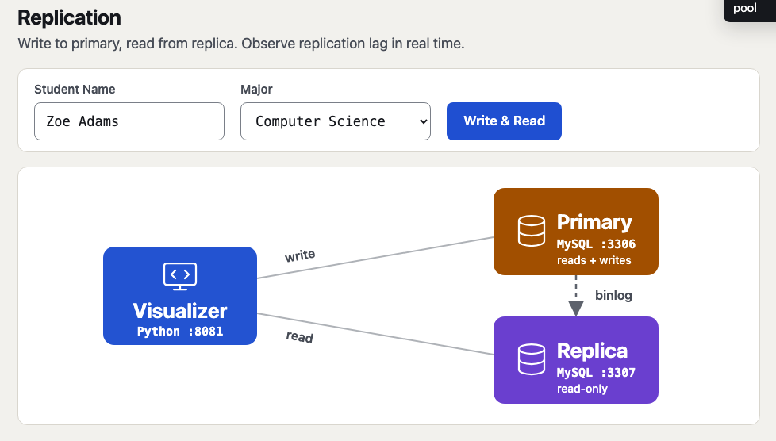

The sidebar on the right shows live database state:

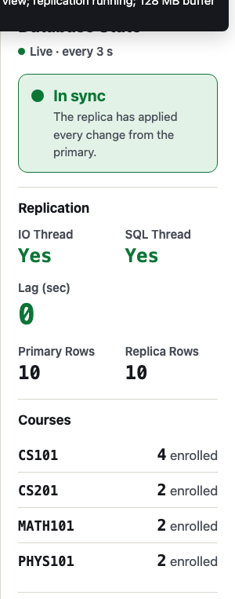

- **IO Thread / SQL Thread**: Both should show `Yes` (replication
  active)
- **Lag (sec)**: Should be `0` (replica is caught up)
- **Primary Rows / Replica Rows**: Both show `10` (same data)
- **Courses**: 4 courses with enrollment counts

### Step 1.2: Open the SQL Console

The **SQL Console** is always open at the bottom right of the page.
Select **Primary**, type the query, and press **Enter** (or click
**Run**):

```sql
SHOW TABLES;
```

You should see: `students`, `courses`, `enrollments`, `access_log`.

Now select **Replica** and run the same query. The replica has
identical tables -- it received them through replication.

> **Note:** If this environment already went through Task 8, the
> primary also lists `bench_data`, and the replica does not. That
> table exists only on the primary (see Step 8.1), and **Reset DB**
> keeps it. Both are expected.

### Step 1.3: Inspect the schema

In the SQL Console (Primary), run:

```sql
DESCRIBE students;
```

Note the columns: `student_id` (auto-increment PK), `name`, `email`
(unique), `major`, `created_at`. This is a relational schema with
enforced constraints -- the database rejects invalid data at the
storage layer, not just in application code.

> **Question:** What is the difference between enforcing uniqueness in
> the application layer vs the database layer?
>
> **Hint:** Think about what happens when two requests try to insert
> the same email simultaneously. Only the database can guarantee
> atomicity across concurrent connections.

---

## Task 2: Replication -- Scaling Reads

Replication lets you distribute read queries across multiple nodes.
The primary handles all writes; replicas receive changes through the
binary log and can serve read traffic independently.

### Step 2.1: Write to primary, read from replica

In the **Replication** tab:

1. Enter a student name (e.g., `Maria Lopez`) and select a major
1. Click **Write & Read**

Watch the animation:

1. Blue arrow (**write**): the INSERT goes to the Primary node
1. Green arrow (**read**): the SELECT finds the row on the Replica
   node. If the first read is too early, the arrow flashes red and the
   visualizer reads again until the row arrives
1. Latency pills show real timing for each operation

The result panel shows **REPLICATED** and how long the row took to
reach the replica (a few milliseconds):


### Step 2.2: Verify via SQL Console

Switch to **Replica** in the SQL Console and run:

```sql
SELECT student_id, name, major FROM students ORDER BY student_id DESC LIMIT 3;
```

You should see the student you just created. The replica received the
INSERT through replication without any action from you.

### Step 2.3: Try writing to the replica

In the SQL Console, select **Replica** and run:

```sql
INSERT INTO students (name, email, major) VALUES ('Test', 'test@u.edu', 'X');
```

Expected error: `The MySQL server is running with the
--super-read-only option`. Replicas are read-only by design -- this
prevents split-brain scenarios where two nodes accept conflicting
writes.

### Step 2.4: Check replication status

In the SQL Console (Replica), run:

```sql
SHOW REPLICA STATUS\G
```

Look for `Replica_IO_Running: Yes`, `Replica_SQL_Running: Yes`, and
`Seconds_Behind_Source: 0`.

> **Question:** A social media platform has 100,000 read requests per
> second but only 1,000 writes. How does replication help?
>
> **Hint:** Add read replicas to handle the 100:1 read-to-write ratio.
> Each replica independently serves reads, so 10 replicas reduce each
> node's load to ~10,000 reads/second. But all writes still go to one
> primary -- replication scales reads, not writes.

---

## Task 3: ACID Transactions -- Consistency Under Concurrency

ACID (Atomicity, Consistency, Isolation, Durability) guarantees that
database transactions are reliable. The key property here is
**atomicity**: a transaction either fully succeeds or fully rolls
back. No partial state exists.

### Step 3.1: Successful transfer

Switch to the **Consistency (ACID)** tab.

The controls show a student enrollment transfer: move Student 1 from
CS101 to PHYS101.

1. Set Student ID to `1`, From Course to `CS101`, To Course to `PHYS101`
1. Click **Transfer Enrollment**

Watch the animation step through:

1. `BEGIN` -- start the transaction
1. `DELETE enrollment (CS101)` -- remove the old enrollment
1. `UPDATE CS101 enrolled-1` -- decrement the count
1. `INSERT enrollment (PHYS101)` -- add the new enrollment
1. `UPDATE PHYS101 enrolled+1` -- increment the count
1. `COMMIT` -- make all changes permanent

The result shows **COMMITTED**. Check the sidebar: CS101 dropped from
4 to 3, PHYS101 went from 2 to 3:

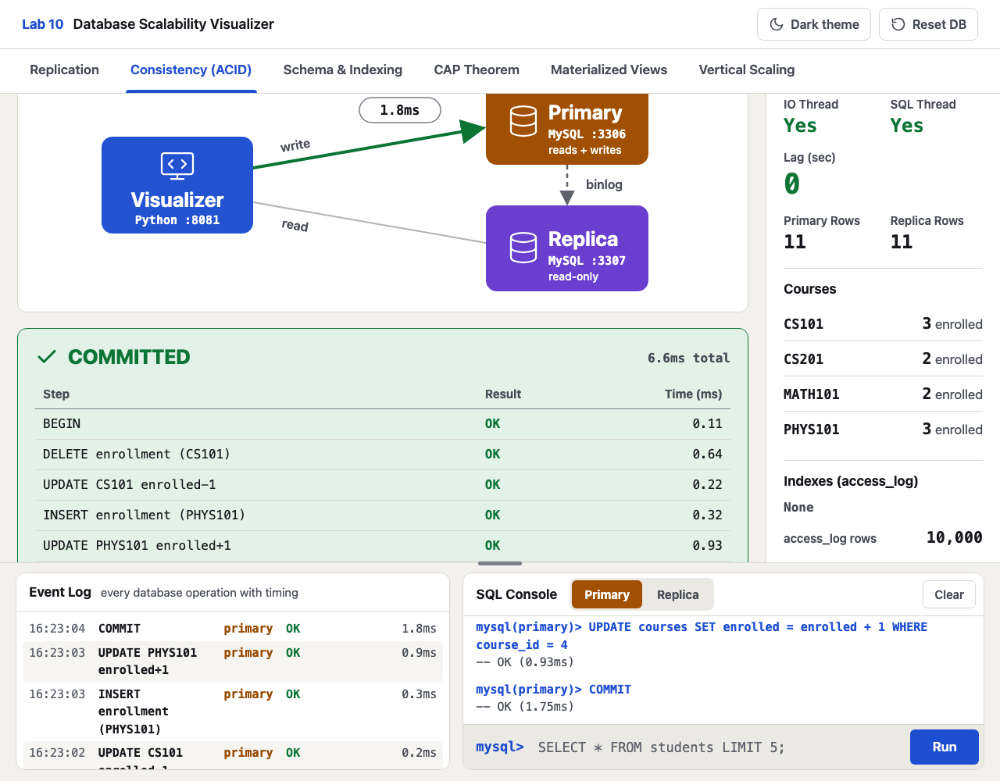

### Step 3.2: Trigger a rollback

Now move Student 3 from CS101 to CS201. Student 3 is already enrolled
in CS201, so the transaction will fail halfway:

1. Set Student ID to `3`, From Course to `CS101`, To Course to `CS201`
1. Click **Transfer Enrollment**

Watch the steps: the DELETE from CS101 and the `UPDATE CS101
enrolled-1` succeed, then the INSERT into CS201 fails with
**CONSTRAINT VIOLATION** (duplicate enrollment). The result shows
**ROLLED BACK**: MySQL undid the DELETE and the UPDATE that had
already run. Check the sidebar: CS101 still shows 3 and CS201 still
shows 2.

If you try a transfer for a student who is not enrolled in the From
course, the transaction stops at the first step with **NOT ENROLLED**
and MySQL rolls it back the same way.

### Step 3.3: Verify atomicity via SQL Console

In the SQL Console (Primary), run:

```sql
SELECT code, enrolled FROM courses ORDER BY code;
```

Confirm the counts match what the sidebar shows. The failed
transaction left zero trace in the database.

> **Question:** A banking system transfers $100 from Account A to
> Account B. The debit from A succeeds, but the credit to B fails
> (network error). What happens without ACID?
>
> **Hint:** Without atomicity, the $100 disappears -- debited from A
> but never credited to B. With ACID, the entire transaction rolls
> back, and Account A keeps its money. This is why financial systems
> require ACID compliance.

---

## Task 4: Schema Design -- Indexing for Performance

As tables grow, query performance depends on whether the database can
find rows efficiently. Without an index, MySQL must scan every row
(full table scan). With the right index, it jumps directly to
matching rows.

### Step 4.1: EXPLAIN without an index

Switch to the **Schema & Indexing** tab.

The controls show a query: find access log entries for Student 3
accessing resource-10.

1. Set Student ID to `3`, Resource to `resource-10`
1. Click **Run EXPLAIN**

The result shows **Rows scanned** close to 10,000 in red, with Key:
**NONE (full scan)**. MySQL examined nearly all 10,000 rows to find a
few dozen matches. EXPLAIN reports an estimate, so the exact number
varies slightly between installations. Check the sidebar: Indexes shows **None**:

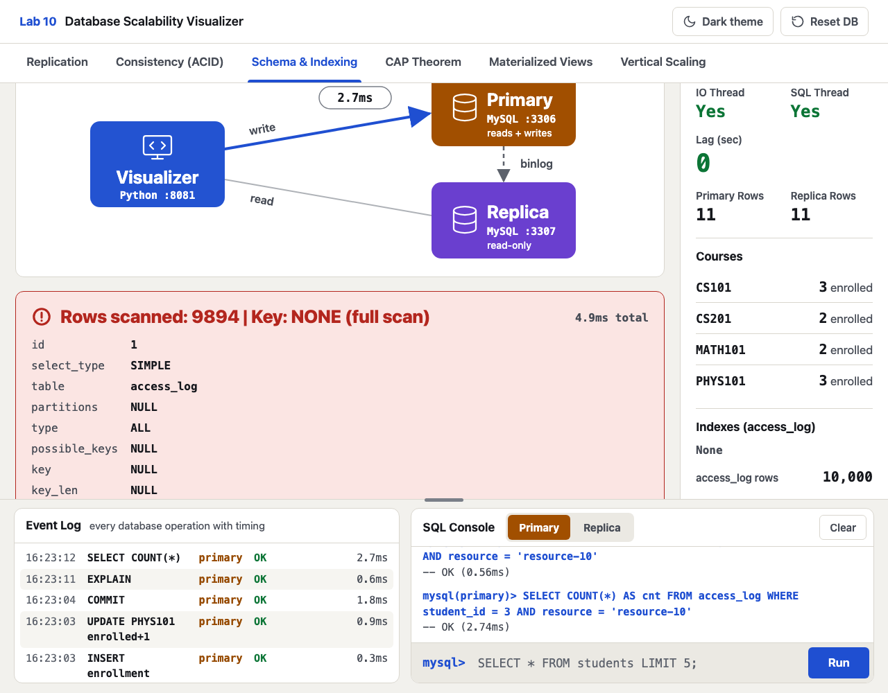

### Step 4.2: Add a composite index

Click **Add Index**. This creates a composite index on
`(student_id, resource)`.

Check the sidebar: Indexes now shows **idx_student_resource**.

### Step 4.3: EXPLAIN with the index

Click **Run EXPLAIN** again (same query).

The result now shows **Rows scanned** in green, with Key:
**idx_student_resource**. The number is just the matching rows (a few
dozen; the sample data is random, so it differs per installation).
MySQL used the index to jump directly to them -- hundreds of times
less work than the full scan:

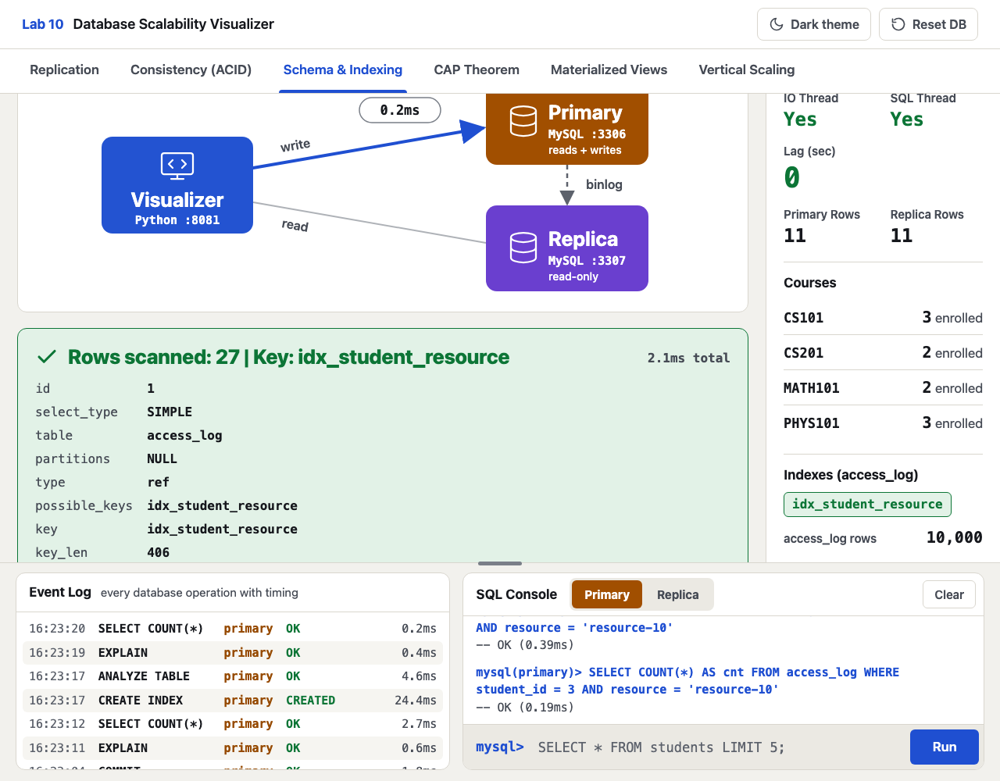

### Step 4.4: Verify via SQL Console

In the SQL Console (Primary), compare:

```sql
EXPLAIN SELECT * FROM access_log WHERE student_id = 3 AND resource = 'resource-10';
```

Look at the `type` column: `ref` (index lookup) instead of `ALL`
(full scan). The `rows` column confirms the improvement.

### Step 4.5: Understand the trade-off

Drop the index: click **Drop Index**.

Now run an INSERT in the SQL Console (Primary):

```sql
INSERT INTO access_log (student_id, resource)
VALUES (1, 'resource-99');
```

Note the latency. Now add the index back (click **Add Index**) and
run the same INSERT again. With the index, writes take slightly
longer because MySQL must update both the table and the index.

> **Question:** An e-commerce site has a `products` table with 10
> million rows. Searches by `category` are slow. Should you add an
> index on `category`?
>
> **Hint:** If the table has 50 categories with roughly equal
> distribution, an index on `category` returns ~200,000 rows per
> lookup. The index helps, but a composite index like
> `(category, price)` would be far more selective if queries also
> filter by price range.

---

## Task 5: SQL Console Exploration

Use the SQL Console to verify what you learned. The console takes
one statement at a time on a single line: paste multi-line queries
from this guide and they run as one line.

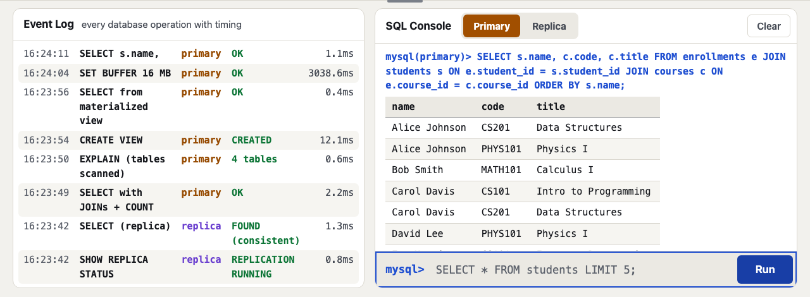

**Check which students are enrolled in which courses:**

```sql
SELECT s.name, c.code, c.title
FROM enrollments e
JOIN students s ON e.student_id = s.student_id
JOIN courses c ON e.course_id = c.course_id
ORDER BY s.name;
```

**Compare primary vs replica data:**

Run the same SELECT on both Primary and Replica to verify they
return identical results.

**Watch replication:**

With **Primary** selected, insert a student:

```sql
INSERT INTO students (name, email, major) VALUES ('Lab Test', 'lab.test@university.edu', 'Physics');
```

Switch to **Replica** and run
`SELECT name FROM students WHERE email = 'lab.test@university.edu';`.
The row is already there: the replica applied it through the binary
log. In the sidebar, **Primary Rows** and **Replica Rows** match.

**Reset the database:**

Click the **Reset DB** button in the top-right corner to restore
the original data (10 students, 4 courses, 10 enrollments, no
custom indexes). Reset also restarts replication if you stopped it,
drops the materialized view, and sets the buffer pool back to 128 MB.
It keeps the `bench_data` benchmark table from Task 8, so the next
benchmark does not have to rebuild it.

---

## Task 6: CAP Theorem -- Partition Tolerance

The CAP theorem states that a distributed system can guarantee at most
two of three properties: Consistency, Availability, and Partition
Tolerance. In this task you simulate a network partition and observe
how MySQL handles it.

### Step 6.1: Stop replication (simulate partition)

Switch to the **CAP Theorem** tab. Click **Stop Replication**.

This runs `STOP REPLICA` on the replica node, halting both the IO
and SQL threads. New writes to the primary will NOT propagate to the
replica -- this simulates a network partition.

### Step 6.2: Write and compare

Click **Write & Compare**. The visualizer inserts a new student on
the primary, then reads from both nodes:

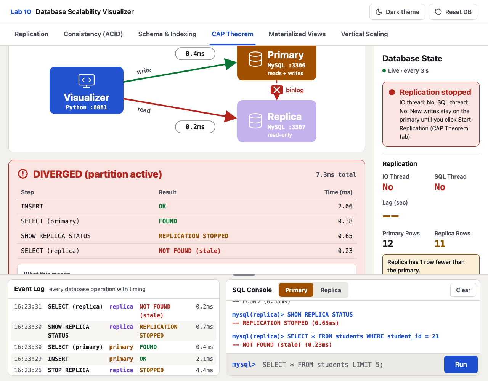

The result shows **DIVERGED (partition active)**:

- Primary: FOUND (has the new data)
- Replica: NOT FOUND (stale -- partition prevents replication)

This is the CAP trade-off: during a partition, you can have
consistency (read from primary only) OR availability (read from
replicas too, but get stale data). MySQL's primary-replica setup
chooses CP when you read from the primary.

### Step 6.3: Recover from partition

Click **Start Replication**, wait a moment, then click
**Write & Compare** again:

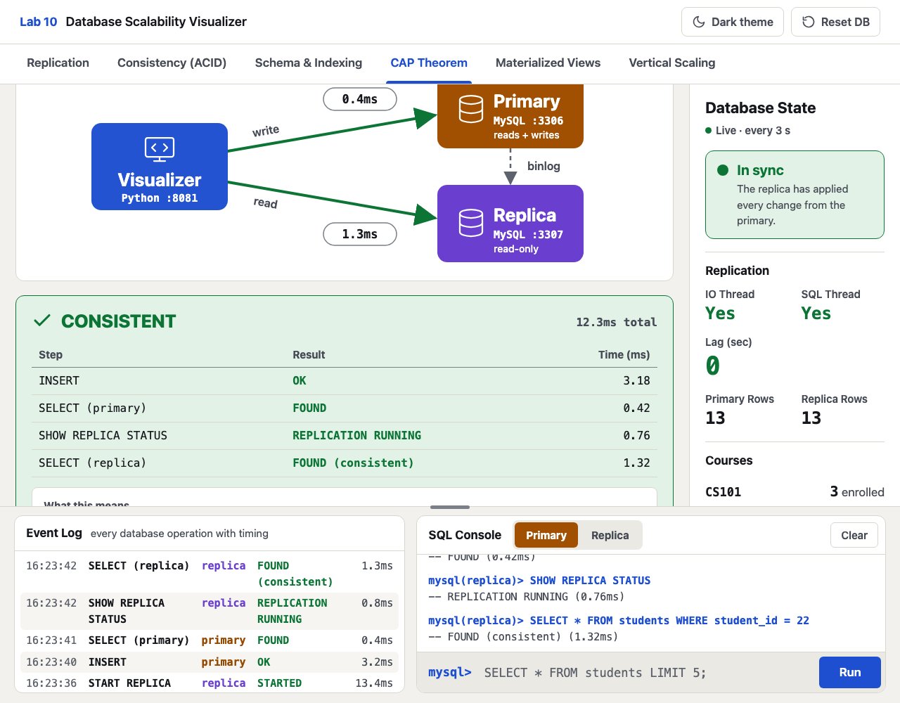

The result shows **CONSISTENT** -- both nodes return the same data.
The replica caught up by replaying missed binlog events.

> **Question:** Netflix reads from replicas for performance. During a
> network partition, users might see stale data (old movie catalog).
> Is this acceptable?
>
> **Hint:** For a streaming catalog, showing a slightly outdated list
> is better than showing nothing. Netflix chooses AP (availability +
> partition tolerance). For a banking app, stale balances would be
> unacceptable -- banks choose CP.

---

## Task 7: Materialized Views -- Read Speed vs Freshness

Materialized views pre-compute expensive queries into a flat table.
Reads become fast, but the view must be refreshed after writes.

### Step 7.1: Query with JOINs (expensive)

Switch to the **Materialized Views** tab. Click **Query with JOINs**.

This runs a JOIN across students, enrollments, and courses, plus a
per-student count of their `access_log` entries -- the kind of report
query that gets expensive as tables grow:


Note the query time, the number of tables scanned (4), and the rows
returned (10, one per enrollment).

### Step 7.2: Create and query the materialized view

Click **Create View** to pre-compute the JOIN result into a single
table. Then click **Query from View**:

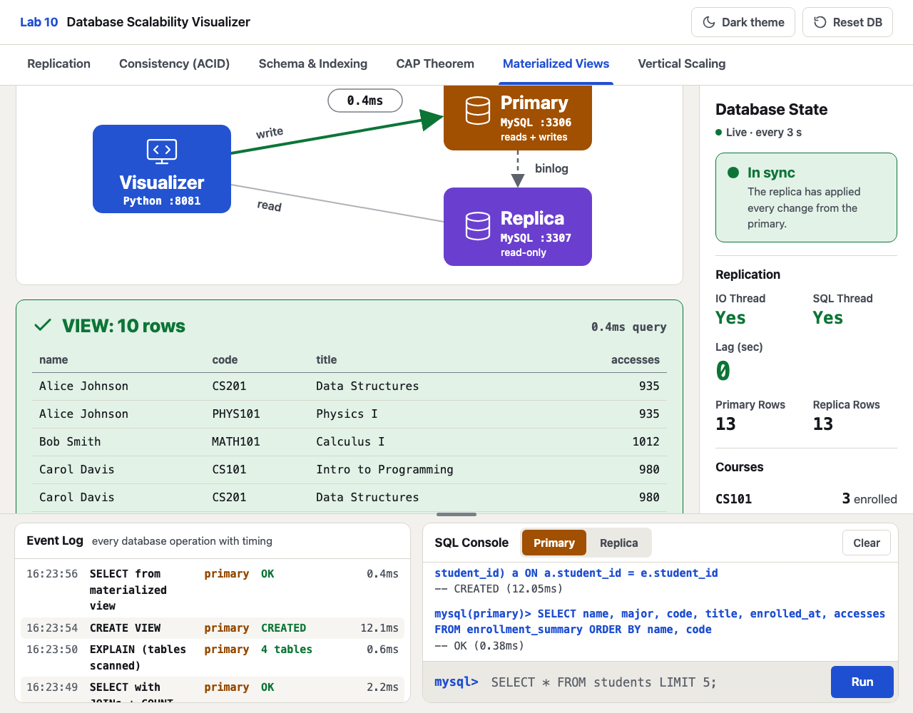

The view query reads from a single flat table -- no JOINs needed.
Compare the timing with Step 7.1.

### Step 7.3: Observe staleness

Use the SQL Console (Primary) to enroll Grace Kim (student 7) in
CS101:

```sql
INSERT INTO enrollments (student_id, course_id) VALUES (7, 1);
```

Now compare the two queries:

1. Click **Query from View**: still **10 rows**, and Grace Kim is not
   in the list. The view is a snapshot taken before the insert.
1. Click **Query with JOINs**: **11 rows**, including Grace Kim. The
   live query always sees the latest data.
1. Click **Refresh View** to rebuild the snapshot, then
   **Query from View** again: now it also returns **11 rows**.

Scroll inside the result box to see every row. Notice that the
sidebar still shows 4 students in CS101: `courses.enrolled` is a
stored counter that only the **Transfer Enrollment** button updates.
Stored totals like this go stale the same way a materialized view
does.

> **Question:** A dashboard shows daily sales summaries for managers.
> Should you use a materialized view or a live JOIN query?
>
> **Hint:** Managers check the dashboard a few times per day. A
> materialized view refreshed hourly gives fast reads with acceptable
> staleness. A live JOIN on every page load would be wasteful.

---

## Task 8: Vertical Scaling -- Buffer Pool Tuning

Vertical scaling means adding more resources (RAM, CPU) to a single
machine. The most impactful vertical scaling lever for MySQL is the
InnoDB buffer pool -- the amount of RAM used to cache data pages.

### Step 8.1: Set a small buffer and benchmark

Switch to the **Vertical Scaling** tab. Select **16 MB** from the
dropdown and click **Set Buffer** (shrinking the buffer takes a few
seconds while MySQL frees memory), then click
**Run Benchmark (200 queries)**:

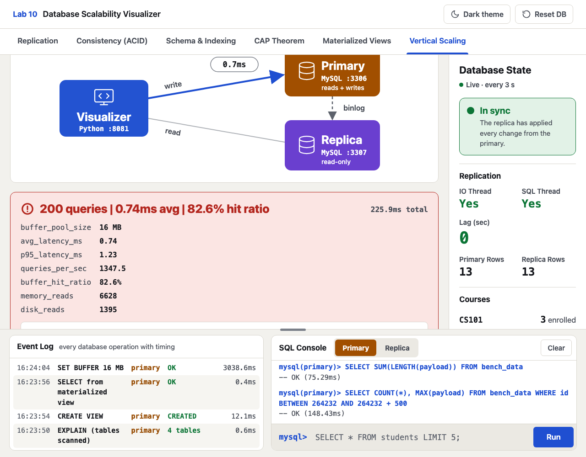

The benchmark reads random ranges of a 72 MB table (`bench_data`),
so a 16 MB buffer cannot hold it all. The visualizer creates that
table the first time you click **Set Buffer** or **Run Benchmark**,
which is why that first click takes longer. It is local benchmark
data: the visualizer builds it with the binary log turned off, so it
exists only on the primary and never reaches the replica. Note the **buffer hit ratio** (around 80-85%),
**avg latency**, and **queries/sec**.

### Step 8.2: Set a large buffer and benchmark again

Select **256 MB**, click **Set Buffer**, then
**Run Benchmark (200 queries)** again.

Compare the results. With more RAM, the buffer hit ratio rises to
100% and query latency decreases -- the whole table is now served
from memory instead of disk. Try **64 MB** and **128 MB** as well:
the hit ratio climbs to about 97% and then 100%.

### Step 8.3: Understand the ceiling

Vertical scaling has diminishing returns. In your measurements, going
from 128 MB to 256 MB changed nothing: once the entire working set
fits in the buffer pool, adding more RAM provides no benefit. And
every machine has a physical limit -- you cannot add infinite RAM.

This is why horizontal scaling (replication, sharding) exists: when
a single machine cannot handle the load, you distribute it across
multiple machines.

> **Question:** Your database server has 64 GB RAM and the dataset is
> 60 GB. Adding more RAM would cost $500/month. Adding a read replica
> would cost $200/month. Which should you choose?
>
> **Hint:** The dataset nearly fills available RAM, so the buffer hit
> ratio is likely already high. More RAM gives diminishing returns. A
> read replica distributes read load across two machines -- better
> value for read-heavy workloads.

---

## Task 9: Free Exploration

Use the SQL Console to explore on your own:


Refer to the previous Task 5 for example queries. Try combining
concepts: add the index with **Add Index** on the Schema & Indexing
tab, then benchmark with different buffer sizes. Or stop replication, insert data, query the materialized view,
and observe the interaction between these mechanisms.

**Reset the database:**

Click the **Reset DB** button in the top-right corner to restore
the original data (10 students, 4 courses, 10 enrollments, no
custom indexes). As in Task 5, the `bench_data` table stays on the
primary.

---

## Cleanup

**Local:**

```bash
./cleanup.sh
```

**EC2:** Delete the `lab10-visualizer` CloudFormation stack in the AWS
Console (see [EC2 Cleanup](#ec2-cleanup) above).

## Troubleshooting

| Issue | Cause | Fix |
| --- | --- | --- |
| Port 8081, 3306, or 3307 in use | Another service (often a local MySQL) uses the port | Stop that service, then run `./setup.sh` again |
| `Conflict ... container name ... in use` | Lab 10A (MySQL CLI) is still running | Run `../mysql/cleanup.sh`, then `./setup.sh` |
| Setup stopped halfway or keeps failing | Half-initialized database volume | Run `./cleanup.sh` and then `./setup.sh` |
| `./setup.sh` does not run on Windows | Scripts need a Linux shell | Run it from WSL or Git Bash |
| SQL Console shows "not allowed" | The console blocks DDL (CREATE, DROP, ALTER) | Use the tab buttons (Add Index, Create View, ...) for schema changes |
| Replica shows `--` in sidebar | Replication not configured | Re-run `./setup.sh` |
| Animation stuck | Previous operation still running | Wait for it to finish or refresh the page |
| EC2 stack ends in ROLLBACK_COMPLETE | Setup failed or timed out | Delete the stack and create it again |
| EC2 page does not load | Your public IP changed | Update the stack with your new IP in **AllowedCidr** |
| EC2 page does not load after the Learner Lab restarts | The instance got a new public IP | Open the visualizer at the new **Public IPv4 address** shown in the EC2 console (the Outputs tab keeps the old one) |
| EC2 stack create fails | Learner Lab not started | Ensure the AWS indicator is green before creating the stack |

## Key Concepts

| Concept | Description |
| --- | --- |
| **Replication** | Copying data from a primary to one or more replicas via binary log |
| **Read replica** | A read-only copy that offloads SELECT queries from the primary |
| **Replication lag** | Delay between a write on primary and its appearance on replica |
| **ACID** | Atomicity, Consistency, Isolation, Durability -- transaction guarantees |
| **Atomicity** | A transaction either fully succeeds (COMMIT) or fully fails (ROLLBACK) |
| **Full table scan** | MySQL reads every row to find matches -- slow on large tables |
| **Composite index** | An index on multiple columns that speeds up multi-column WHERE clauses |
| **EXPLAIN** | Shows MySQL's query execution plan: index used, rows examined |
| **Read-write split** | Send writes to primary, reads to replicas -- the most common scaling pattern |
| **CAP Theorem** | A distributed system can guarantee at most 2 of: Consistency, Availability, Partition Tolerance |
| **Network partition** | A break in communication between nodes -- some nodes cannot reach others |
| **Materialized view** | A pre-computed query result stored as a table for fast reads |
| **View staleness** | A materialized view becomes outdated after new writes until refreshed |
| **Buffer pool** | RAM cache for InnoDB data pages -- larger pool = fewer disk reads |
| **Vertical scaling** | Adding more resources (RAM, CPU) to a single machine |
| **Horizontal scaling** | Adding more machines to distribute the load |

## Conclusions

1. **Replication scales reads, not writes.** Adding replicas
   distributes SELECT queries across multiple nodes, but all writes
   still go to one primary. This is the most common first step in
   scaling a relational database.

2. **ACID prevents data corruption under concurrency.** The
   enrollment transfer either fully succeeds or fully rolls back.
   Without atomicity, partial failures leave the database in an
   inconsistent state -- money disappears, inventory goes negative,
   seats are double-booked.

3. **Indexes are the highest-impact optimization for query
   performance.** A single composite index turned a 10,000-row scan
   into a lookup of a few dozen rows -- hundreds of times less work. But indexes are not
   free: they consume storage and slow down writes. The right index
   depends on your query patterns.

4. **The CAP theorem is a real constraint, not a theoretical
   exercise.** You saw data diverge during a simulated partition.
   Every distributed database makes a CAP trade-off: MySQL
   primary-replica is CP when reading from the primary, but AP when
   reading from replicas for performance.

5. **Materialized views trade freshness for read speed.** Pre-computing
   a JOIN eliminates repeated work, but the view becomes stale after
   writes. The right refresh interval depends on how much staleness
   your application can tolerate.

6. **Vertical scaling has diminishing returns.** More RAM improves
   buffer hit ratio, but once the working set fits in memory, adding
   more RAM provides no benefit. This is why horizontal scaling
   (replication, sharding) exists -- it breaks the single-machine
   ceiling.

## Next Steps (Optional)

For deeper hands-on work with other database paradigms, try the
optional labs:

- [Lab 10A -- MySQL CLI](../mysql/LAB-MYSQL.md) -- same mechanisms
  via the command line
- [Lab 10B -- MongoDB](../mongodb/LAB-MONGODB.md) -- replica sets,
  tunable consistency, denormalized schema
- [Lab 10C -- Cassandra](../cassandra/LAB-CASSANDRA.md) -- multi-node
  ring, consistency levels, partition key design
