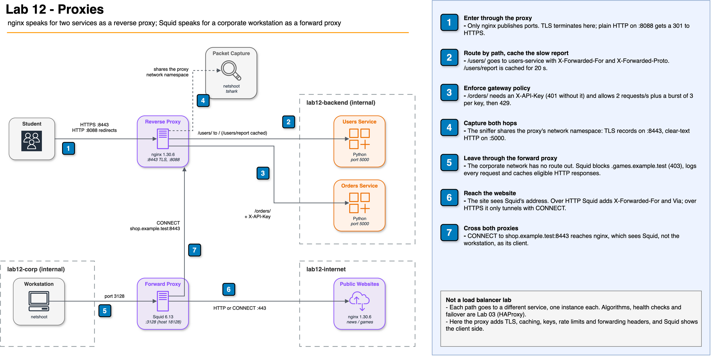

# Proxies: Reverse and Forward Proxies with nginx and Squid


## Overview

This hands-on lab puts a proxy in the middle of a conversation and measures what changes. Students run nginx as a
**reverse proxy** in front of two services, terminating TLS, routing by path, caching a slow response, and enforcing
API keys and rate limits, and they capture the packets on both sides of it. They then switch to the client side:
a corporate workstation that can only reach the internet through **Squid**, a **forward proxy** that filters,
caches, logs, and tunnels HTTPS. Everything runs locally in Docker Compose.

## Lab Instructions

All lab work runs in Docker containers, so the commands are the same on every operating system. Follow the
step-by-step instructions in **[LAB.md](LAB.md)**.

| Environment | Requirements | Setup |
| --- | --- | --- |
| Local (Docker Desktop) | Docker Desktop, curl, openssl, bash terminal | `./setup.sh` |

## Learning Objectives

- Distinguish a reverse proxy (acts on behalf of servers) from a forward proxy (acts on behalf of clients)
- Configure nginx as the single entry point to several services with path-based routing
- Terminate TLS at the proxy and verify with a packet capture which hop is encrypted and which is not
- Cache responses at the proxy and measure cold versus warm latency
- Enforce gateway policies at the edge: API keys (`401`) and per-client rate limiting (`429`)
- Explain `X-Forwarded-For`, `X-Forwarded-Proto` and `X-Real-IP`, and why the first one can be forged
- Use a forward proxy to control, cache, and log outbound traffic, and explain what it cannot see in HTTPS
- Trace one request through a forward proxy and a reverse proxy and state what each hop knows

## Prerequisites

- **Docker Desktop** installed and running (includes Docker Compose)
- **curl** and **openssl** (both ship with macOS, Linux, and Git for Windows)
- Basic HTTP knowledge (methods, status codes, headers) and the TLS basics from Lab 06
- No cloud account required; the host ports used are `8088`, `8443`, and `18128`

## Architecture

The reverse proxy is the only container that publishes ports for the services. The services sit on an internal
network that nobody else can reach. On the other side, the workstation sits on an internal corporate network whose
only way out is Squid.



[Edit this diagram](diagrams/lab12-architecture.drawio)

| Container | Image | Networks | Role |
| --- | --- | --- | --- |
| `lab12-proxy` | `nginx:1.30.6-alpine` | backend, internet | Reverse proxy, alias `shop.example.test` |
| `lab12-users`, `lab12-orders` | built from `backend/` (`python:3.15.0-alpine3.24`) | backend | Services that echo what they saw |
| `lab12-sniffer` | `nicolaka/netshoot:v0.16` | proxy's namespace | `tcpdump` and `tshark` |
| `lab12-forward-proxy` | `ubuntu/squid:6.6-24.04_beta` (pinned by digest) | corp, internet | Forward proxy |
| `lab12-public-site` | `nginx:1.30.6-alpine` | internet | `news.example.test`, `games.example.test` |
| `lab12-workstation` | `nicolaka/netshoot:v0.16` | corp | An employee laptop |

**How this lab differs from Lab 03:** Lab 03 used HAProxy to spread requests over five identical servers and
compared balancing algorithms, health checks, and failover. Here each path goes to a **different** service with one
instance each, so no algorithm is involved. The lab studies what a proxy adds by sitting in the middle: TLS,
caching, edge policies, forwarding headers, and the client-side view through a forward proxy.

## Lab Structure

```text
12-proxies/
├── README.md                     # This file (lab overview)
├── LAB.md                        # Step-by-step instructions (8 tasks)
├── diagrams/                     # Architecture diagram (draw.io source + PNG)
├── docker-compose.yml            # Seven containers on three networks
├── setup.sh                      # Generate certificates, start and verify everything
├── cleanup.sh                    # Remove containers, networks, image, and certificates
├── .gitignore                    # Keeps the generated certs/ directory out of git
├── backend/
│   ├── Dockerfile                # Python service image (non-root)
│   └── app.py                    # Echoes client address and forwarding headers; slow /report
├── nginx/
│   ├── reverse-proxy.conf        # TLS, routing, cache, API keys, rate limits, headers
│   └── public-site.conf          # The two "internet" websites
├── squid/
│   └── squid.conf                # Allowed clients, blocklist, CONNECT ports, cache, logging
├── scripts/
│   ├── capture-tls.sh            # Captures both hops of one request and finds a marker
│   ├── measure-cache.sh          # Times repeated requests to the cached report
│   └── burst.sh                  # Sends a burst with an API key and tallies status codes
└── certs/                        # Created by setup.sh, ignored by git (never committed)
```

## Quick Start

```bash
./setup.sh
```

The setup script generates two self-signed certificates with `openssl`, builds the service image, starts all
containers, waits for their health checks, and runs one request through each proxy. Follow [LAB.md](LAB.md) for the
full 8-task walkthrough.

## Tasks Overview

| Task | Topic | What You Do |
| --- | --- | --- |
| 1. Start and Meet the Proxy | Reverse proxy | Confirm only the proxy is reachable and that it hides the backend's identity |
| 2. Path Routing | Single entry point | Route `/users/` and `/orders/` to different services; see prefix rewriting |
| 3. TLS Termination | Security | Redirect HTTP, inspect the certificate, capture both hops with `tshark` |
| 4. Caching | Performance | Measure `MISS` vs `HIT` (about 1500 ms vs 5 ms) and watch a copy expire |
| 5. Gateway Policies | Edge control | Get `401` without a key and `429` past 2 requests/s per key |
| 6. Forwarding Headers | Observability | Compare a naive rule with a correct one in the service log; forge `X-Forwarded-For` |
| 7. Forward Proxy | Outbound control | Reach the internet only through Squid; blocklist, shared cache, `CONNECT` |
| 8. Both Proxies | End to end | Follow one request through Squid and nginx and fill in what each hop knew |

## Cleanup

```bash
./cleanup.sh
```

The cleanup script stops and removes all containers, the three networks, the locally built image, and the
generated `certs/` directory. Verify with `docker ps -a --filter name=lab12-`.

## Troubleshooting

| Issue | Cause | Fix |
| --- | --- | --- |
| `Cannot connect to the Docker daemon` | Docker not running | Start Docker Desktop |
| `port is already allocated` on 8088, 8443 or 18128 | Another program uses the port | Stop it, or change the left side of `ports:` in `docker-compose.yml` |
| `curl: (60) SSL certificate problem` | curl does not trust the self-signed certificate | Add `--cacert certs/proxy.crt` (Task 3 explains why) |
| `curl: (77) error setting certificate file` | Command run outside `12-proxies/` or `certs/` missing | `cd 12-proxies` and re-run `./setup.sh` |
| `Could not resolve host: news.example.test` | Expected without a proxy (Task 7) | Add `-x http://forward-proxy:3128` inside the workstation |
| Every request returns `429` | The bucket for that key is still full | Wait two seconds; each key refills at 2 requests per second |
| `X-Cache-Status` never shows `HIT` | Requests sent to `/users/` instead of `/users/report` | Only `/users/report` is cached |
| `tshark` prints nothing | The request was sent before the capture started | Start the capture first, then send the request within 15 seconds |
| `cat /var/log/nginx/access.log` in the proxy never ends | The file is a link to the container's stdout | Read the log with `docker logs lab12-proxy` instead |
| Changes to `nginx/reverse-proxy.conf` have no effect | nginx reads its configuration at start | `docker exec lab12-proxy nginx -t && docker exec lab12-proxy nginx -s reload` |

## Key Concepts

| Concept | Description |
| --- | --- |
| **Proxy** | An intermediary that receives a request, may inspect or change it, and sends it on |
| **Reverse proxy** | Acts on behalf of servers; clients only see the proxy (nginx, HAProxy, Envoy, CDNs) |
| **Forward proxy** | Acts on behalf of clients; servers only see the proxy (Squid, corporate web gateways) |
| **TLS termination** | The proxy decrypts HTTPS and talks plain HTTP (or new TLS) to the services |
| **SNI** | Server name sent in clear text in the TLS Client Hello so the proxy can pick a certificate |
| **Proxy cache** | Responses stored by the proxy and reused until they expire (`MISS`, `HIT`, `EXPIRED`) |
| **Rate limiting** | Rejecting requests above a rate per client; nginx uses a leaky bucket and answers `429` |
| **API key** | A client identifier checked at the edge before a request reaches any service |
| **X-Forwarded-For** | List of client and proxy addresses; each proxy appends the address it saw |
| **X-Forwarded-Proto** | Original scheme (`https`) so services build correct links and secure cookies |
| **CONNECT** | HTTP method that asks a forward proxy to open a raw TCP tunnel, used for HTTPS |
| **Via** | Header a proxy adds to name itself in the request path |

### Forward vs Reverse Proxy

| | Forward proxy (Squid) | Reverse proxy (nginx) |
| --- | --- | --- |
| Acts on behalf of | Clients (the workstation) | Servers (users and orders services) |
| Who configures it | The client side (browser, `https_proxy`, `-x`) | The server side (DNS points to it) |
| Hides | The client's address from websites | The services' addresses and technology from clients |
| Typical owner | A company's network or security team | The team that runs the website or API |
| Typical jobs | Filtering, outbound logging, shared cache | TLS, routing, caching, rate limits, API gateway |
| Sees HTTPS content | No, only `CONNECT host:port` (unless it intercepts TLS) | Yes, it holds the certificate |

## How This Relates to Scalable Systems Design

**A proxy is where cross-cutting concerns live.** Every service needs TLS, logging, protection from abuse, and
sometimes caching. Writing those in each service multiplies the code and the mistakes. A reverse proxy or API
gateway does them once at the edge, and the services focus on business logic. This is the same idea as the API
gateway in the module's class: Kong, for example, is built on nginx.

**The proxy decouples clients from topology.** Clients know one name and a set of paths. Services can move, split,
or be renamed behind the proxy without any client release. This is what makes it possible to break a monolith into
services one path at a time.

**Caching and rate limiting at the edge protect the expensive layers.** In Task 4 one request out of five reached
the service. In Task 5 the rejected requests cost the service nothing. At scale, the cheapest request is the one
that never reaches your application or your database.

**Every proxy changes what the next hop knows.** After a proxy, the TCP peer is the proxy. Logging, rate limiting
by address, geolocation, and redirects all break unless the forwarding headers are set, and they become a
security hole if they are trusted from anyone. A forward proxy in front of many users makes them all look like one
address, which is why serious APIs limit by key or identity rather than by IP.

**Connection to other labs:** Lab 03 balanced load across identical servers; a production reverse proxy usually
does both jobs. Lab 06 issued certificates; here the proxy holds them for every service. Lab 11 cached inside the
application; this lab caches in the infrastructure without changing any service code.

## Conclusions

After completing this lab, you should take away these lessons:

1. **Direction defines the proxy.** A forward proxy is chosen by clients and hides them; a reverse proxy is chosen
   by servers and hides them. The software can be the same. What differs is whose side it is on.

2. **TLS termination moves trust to the proxy.** One place holds the private key and renews certificates, and the
   proxy can read and route every request. The price is clear text on the inside network, which you either accept,
   isolate, or re-encrypt.

3. **A proxy cache is cheap to add and easy to misuse.** It needs no code change and cut latency from about
   1500 ms to under 10 ms here. It is also blind to meaning: it caches by URL, so per-user data must never share a
   cache key.

4. **Enforce limits at the edge, keyed by identity.** Rejected requests should cost the services nothing, and limits
   keyed by IP address punish everyone behind a shared proxy or NAT.

5. **Never trust forwarding headers from strangers.** `X-Forwarded-For` is a list anyone can start. Trust only the
   entries written by proxies you control.

## Next Steps

- [Module 13 -- Solutions Architecture](../13-solutions-architecture/) -- combine proxies, caches, and databases
  into complete designs
- [nginx reverse proxy guide](https://docs.nginx.com/nginx/admin-guide/web-server/reverse-proxy/) -- upstreams,
  headers, buffering, and timeouts
- [nginx rate limiting](https://blog.nginx.org/blog/rate-limiting-nginx) -- burst, `nodelay`, and two-stage limits
- [Squid configuration reference](https://www.squid-cache.org/Doc/config/) -- ACLs, `http_access`, and SSL bumping
- [RFC 7239: Forwarded HTTP Extension](https://datatracker.ietf.org/doc/html/rfc7239) -- the standard successor
  of `X-Forwarded-For`
- [Amazon API Gateway](https://docs.aws.amazon.com/apigateway/) -- a managed gateway with throttling, API keys, and
  caching
