# Solutions Architecture: Complete the Diagram on Four Clouds


## Overview

This lab turns solutions architecture into a "complete the diagram" exercise. Each scenario
describes a business problem, a fixed topology, and a list of numbered requirements; students drag
the managed service that meets each requirement into the matching gap of the diagram. The exercise has 9
scenarios, each available on AWS, Azure, Google Cloud, and Oracle Cloud (36 puzzles), so students can
solve and compare the same design across providers. Scenario 9 rebuilds the multi-Region DNS plus
load balancer pattern from [Lab 04](../04-dns-dig-bind9/), and its score is the lab deliverable.

The exercise is a static website: playing it needs no Docker, no cloud account, and no
installation. Follow the step-by-step instructions in **[LAB.md](LAB.md)**.

| Environment | Requirements | Setup |
| --- | --- | --- |
| Published site | A modern web browser | Open [Complete the diagram](https://hallowed-denim-9pax.here.now/) |
| Local build (optional) | bash, curl, Python 3, internet for the first build | `cd arch-builder && ./build.sh` |

## Learning Objectives

- Map written non-functional requirements (availability, latency, security, cost) to managed cloud
  services
- Distinguish a service from its near-miss alternative by the exact words of a requirement
- Explain how DNS-level health checks and load balancer health checks recover from different
  failures in a multi-Region design
- Compare how AWS, Azure, Google Cloud, and Oracle Cloud implement the same topology
- Identify services with no clean equivalent on another cloud, and regional availability limits
- Justify an architectural choice with the provider's official documentation

## Prerequisites

- A modern web browser (Chrome, Edge, Firefox, or Safari) with JavaScript enabled
- [Lab 04 -- DNS: dig and BIND9](../04-dns-dig-bind9/), especially its multi-Region class diagram
- [Lab 03 -- Load Balancing](../03-load-balancing-haproxy/) concepts: health checks and failover
- For the optional local build only: a bash terminal, `curl`, Python 3.10 or later, and an internet
  connection to download the official icon packages (about 23 MB, cached after the first build)

## Architecture

The exercise is a self-contained static site. A build step validates the puzzles, downloads the
official icon package of each provider, verifies its SHA-256 checksum, and writes the site to
`dist/`. Players only need a browser; progress and the language choice live in the browser's
`localStorage`, never on a server.



[Edit this diagram](diagrams/lab13-architecture.drawio)

Every scenario uses the same topology on the four clouds: same gaps, nodes, and arrows. Only the
services, the group types (VPC, VNet, VCN), the explanations, and the documentation links change.

## Lab Structure

```text
13-solutions-architecture/
├── README.md                       # This file (lab overview)
├── LAB.md                          # Step-by-step instructions (5 tasks + deliverable)
├── ARCHITECTURES.md                # Scenario design, answers and sources per cloud (Spanish)
├── diagrams/                       # Architecture diagrams (draw.io source + PNG)
├── presentation/                   # Class slides
├── presentation-alt-ckm-slides/    # Alternative class slides
└── arch-builder/
    ├── build.sh                    # Validate puzzles, fetch icons, write dist/
    ├── AUTHORING.md                # How to write a scenario (Spanish)
    ├── ICONS.md                    # Official icon packages, URLs and checksums (Spanish)
    ├── app/                        # index.html, app.js, core.js, render.js, app.css, i18n/
    ├── puzzles/                    # eNN-<cloud>.json puzzles; en/ holds the English translations
    ├── icons/                      # registry.json and packages.tsv (no images are committed)
    ├── schema/                     # puzzle.schema.json
    ├── scripts/fetch-icons.sh      # Download, verify and extract the icons
    ├── tools/                      # build.py (validator + site builder), icons.py
    └── tests/                      # node --test and unittest suites
```

`ARCHITECTURES.md` lists the answer of every slot. Open it only after you play a scenario.

## Quick Start

Open the published exercise in your browser:

```text
https://hallowed-denim-9pax.here.now/
```

Click **English** in the top bar, then follow [LAB.md](LAB.md). To build the site locally instead:

```bash
cd 13-solutions-architecture/arch-builder
./build.sh
```

The script prints one `ok` line per puzzle and ends with `build: listo, abre .../dist/index.html`.
Open `dist/index.html` directly from disk, without a web server.

## Tasks

The lab consists of 5 tasks that build on each other:

| Task | Topic | What You Do |
| --- | --- | --- |
| 1. Open the Exercise | Setup | Open the site (or build it), switch to English, tour the start screen |
| 2. Scenario 9 on AWS | DNS + load balancing | Solve the multi-Region scenario from Lab 04 and capture the score |
| 3. Scenario 9 on Another Cloud | Comparison | Solve the same topology on Azure, Google Cloud, or Oracle Cloud |
| 4. Scenarios by Topic | Practice | Pick scenarios that match earlier labs; try Challenge mode |
| 5. Cross-Cloud Equivalences | Reflection | Build an equivalence table and study the services without a clean match |

**Deliverable:** a screenshot of the finished Scenario 9 on AWS that shows the score. See the
[Deliverable](LAB.md#deliverable) section of the lab.

## Cleanup

This lab creates no cloud resources or containers. If you built the site locally, delete the
build output and the icon cache:

```bash
cd 13-solutions-architecture/arch-builder
rm -rf dist .cache
```

To reset your progress, clear the site data for the exercise in your browser settings. The site
stores two `localStorage` keys: `dse_arch_v1` (progress) and `dse_arch_lang` (language).

## Troubleshooting

| Issue | Cause | Fix |
| --- | --- | --- |
| The page shows `Este ejercicio necesita JavaScript.` | The browser blocks JavaScript | Enable JavaScript for the site |
| The interface is in Spanish | Spanish is the default language | Click **English** in the top bar |
| `This browser does not allow saving progress` | Private browsing or blocked storage | Use a normal window; otherwise the site forgets progress on close |
| `The saved progress was damaged and was reset.` | Corrupted `localStorage` value | Nothing to do; the site starts over |
| A slot does not accept a change | The slot was already graded in this attempt | Click **Try again** first; correct slots stay locked |
| No **Hint** button | Challenge mode has no hints | Switch to Practice on the start screen |
| A scenario shows a **Draft** tag | The scenario is still under review | Play it normally and report anything that looks wrong |
| `./build.sh` fails with `no se pudo descargar` | No internet or the provider moved the package | Check your connection; see `arch-builder/ICONS.md` |
| `./build.sh` reports `el sha256 ... no coincide` | The provider changed the icon package | Report it; do not edit the checksums by hand |
| Diagram labels are too small | Narrow window | Click **Enlarge diagram** or press `Z` |

## Key Concepts

| Concept | Description |
| --- | --- |
| **Requirement-driven design** | Each component exists because a specific requirement asks for it |
| **Near-miss service** | A plausible alternative that fails one word of the requirement (the distractor) |
| **Global DNS routing** | Latency or failover routing that answers with the healthiest, closest Region |
| **DNS health checks** | Probes from many internet locations that remove a failed Region from DNS answers |
| **Load balancer health checks** | Probes from the balancer to its own targets inside one Region |
| **Auto scaling group** | Keeps a minimum number of instances across zones, replaces failed ones, adds more under load |
| **TTL vs recovery time** | Failover time adds detection, DNS TTL, client DNS caches, and reconnection; it is not just the TTL |
| **Service equivalence** | The closest managed service on another cloud; often similar, rarely identical |
| **Regional availability** | A service can exist on a cloud but not in the Region the design needs |
| **Managed service** | The provider operates the component; you configure it instead of running it |

## Conclusions

After completing this lab, you should take away these lessons:

1. **Requirements pick the service, not the other way around.** The deciding words of a
   requirement ("in different zones", "terminates TLS", "replaces the one that fails") separate the
   right service from its near miss.

2. **Multi-Region availability needs two layers.** DNS chooses the Region and recovers in minutes;
   the load balancer chooses the instance and recovers in seconds. Lab 04 drew this pattern; this
   lab makes you name every piece.

3. **Architectures transfer across clouds; service names do not.** The same topology works on four
   providers, but some pieces live inside another service, need extra glue, or are missing in a
   given Region.

4. **Official documentation is the tie-breaker.** Every explanation in the exercise links to the
   provider's documentation, which is where you verify a design decision.

## Next Steps

- [Module 14 -- Distributed Messaging](../14-distributed-messaging/) -- queues, publish/subscribe,
  and dead-letter queues, which Scenario 8 already introduces
- [AWS Well-Architected Framework](https://docs.aws.amazon.com/wellarchitected/latest/framework/welcome.html)
  -- the design principles behind requirement-driven architectures
- [Azure Architecture Center](https://learn.microsoft.com/en-us/azure/architecture/) -- reference
  architectures for the same patterns on Azure
- [Google Cloud Architecture Center](https://cloud.google.com/architecture) -- reference
  architectures on Google Cloud
- [OCI Architecture Center](https://docs.oracle.com/solutions/) -- reference architectures on
  Oracle Cloud
