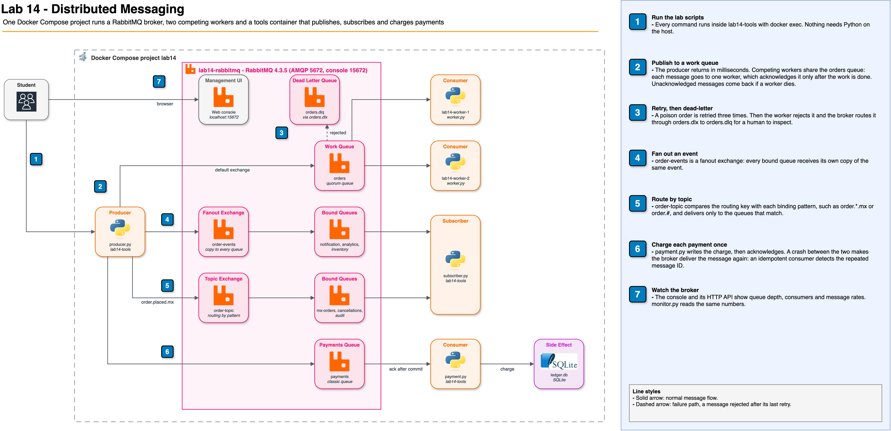

# Distributed Messaging: Queues, Topics and Delivery Guarantees with RabbitMQ


## Overview

This hands-on lab shows why services talk through messages and what that
decision complicates. Students run an online store's checkout as a
producer that publishes orders to RabbitMQ, compare a work queue with
fanout and topic exchanges, stop consumers and restart the broker to see
messages wait without being lost, send a poison message to a dead letter
queue, and provoke a double charge to learn why consumers must be
idempotent. The lab closes by measuring message rates and queue depth.
Everything runs locally in Docker Compose.

## Lab Instructions

All lab work runs inside Docker containers, making the commands
OS-agnostic. Follow the step-by-step instructions in **[LAB.md](LAB.md)**.

| Environment | Requirements | Setup |
| --- | --- | --- |
| Local (Docker Desktop) | Docker Desktop + bash terminal + browser | `./setup.sh` |

## Learning Objectives

- Explain how a message queue decouples a producer from its consumers,
  and measure the difference against a synchronous call
- Distinguish a work queue (competing consumers) from publish/subscribe
  with fanout and topic exchanges, and predict where a message is routed
- Demonstrate that durable queues with persistent messages survive a
  consumer outage and a broker restart, and that transient messages in a
  classic queue do not
- Implement bounded retries and route a poison message to a dead letter
  queue
- Provoke a duplicate delivery, explain at-most-once, at-least-once and
  effectively-once processing, and make a consumer idempotent
- Measure publish rates with and without publisher confirms, and read
  queue depth to decide when to add consumers

## Prerequisites

- **Docker Desktop** installed and running (includes Docker Compose)
- A web browser for the RabbitMQ management console
- Free local ports 5672 and 15672
- Basic Python reading skills: the scripts are short and you will read
  them, but you do not write code
- No cloud account required: everything runs locally via Docker

## Architecture

The lab environment runs entirely in Docker Compose. A RabbitMQ broker
holds the exchanges and queues, two worker containers consume the work
queue, and a tools container runs the producer, the subscribers, the
payment consumer and the monitor.



[Edit this diagram](diagrams/lab14-architecture.drawio)

**Message flow (work queue):**

1. The producer publishes an order to the `orders` queue and returns
2. The broker delivers it to one of the workers that are free
3. The worker processes the order and acknowledges it
4. Only then does the broker delete the message; without an
   acknowledgment it delivers the message again

### Why RabbitMQ

The class presents RabbitMQ, Kafka, Amazon SQS and Redis Streams. This lab
uses RabbitMQ because its exchange types (direct, fanout, topic) let you
see routing, queues and acknowledgments as separate pieces, and its web
console shows queue depth as it changes. The delivery guarantees you
explore here apply equally to the other technologies:

| Lab concept | RabbitMQ | AWS equivalent | Kafka equivalent |
| --- | --- | --- | --- |
| Work queue | Queue with competing consumers | Amazon SQS queue | Consumer group on a topic |
| Fan-out | Fanout exchange | Amazon SNS topic to several SQS queues | Several consumer groups |
| Pattern routing | Topic exchange | SNS subscription filter policies | Separate topics or consumer-side filtering |
| Dead letter queue | Dead letter exchange | SQS redrive policy | Dead letter topic, built by the application |
| Acknowledgment | `basic.ack` | `DeleteMessage` | Committed offset |

## Lab Structure

```text
14-distributed-messaging/
├── README.md               # This file (lab overview)
├── LAB.md                  # Step-by-step instructions (6 tasks)
├── docker-compose.yml      # RabbitMQ, two workers, tools container
├── setup.sh                # Start environment and declare the topology
├── cleanup.sh              # Tear down containers, volumes and image
├── diagrams/               # Architecture diagram (draw.io source + PNG)
├── presentation/           # Class slides for this module
├── presentation-alt-ckm-slides/
└── app/
    ├── Dockerfile          # Python 3.13 image shared by every container
    ├── requirements.txt    # pika, pinned
    ├── broker.py           # Connection settings and the full topology
    ├── topology.py         # Declares exchanges, queues and bindings
    ├── producer.py         # Publishes orders (async, sync, confirms, rate)
    ├── worker.py           # Competing consumer with retries and DLQ
    ├── subscriber.py       # Reads one queue and prints its messages
    ├── payment.py          # Payment consumer that can crash on purpose
    ├── ledger.py           # SQLite ledger: shows double charges
    └── monitor.py          # Queue depth and rates from the management API
```

## Quick Start

```bash
./setup.sh
```

The setup script builds the Python image, starts RabbitMQ, one worker and
the tools container, waits until the broker and its console respond, and
declares every exchange, queue and binding. Then open
<http://localhost:15672> (user `lab14`, password `lab14-pass`) and follow
[LAB.md](LAB.md) for the full 6-task walkthrough.

## Tasks Overview

The lab consists of 6 tasks that build on each other:

| Task | Topic | What You Do |
| --- | --- | --- |
| 1. Publish Without Waiting | Decoupling | Publish 50 orders in milliseconds, watch the worker drain them, compare with a synchronous call |
| 2. Queue Versus Topic | Routing | Split work between two workers, fan one event out to three queues, route by topic pattern |
| 3. The Consumer Goes Down | Durability | Stop the workers, let messages accumulate, restart the broker, kill a worker mid-message |
| 4. Retries and the DLQ | Failure handling | Retry a poison order three times and inspect it in the dead letter queue |
| 5. At-Least-Once Versus Exactly-Once | Delivery guarantees | Lose payments with auto-ack, provoke a double charge, fix it with an idempotent consumer |
| 6. Throughput and Queue Depth | Measurement | Measure publish rates with and without confirms, watch a backlog grow and drain |

## Cleanup

macOS / Linux:

```bash
./cleanup.sh
```

The cleanup script stops all containers, removes the `lab14` network and
volumes, and deletes the locally built `lab14-app:local` image.

## Troubleshooting

| Issue | Cause | Fix |
| --- | --- | --- |
| `docker: command not found` | Docker not installed | Install Docker Desktop |
| `Cannot connect to the Docker daemon` | Docker not running | Start Docker Desktop |
| `port is already allocated` for 5672 or 15672 | Another RabbitMQ or service uses the port | Stop it, or change the host side of the port in `docker-compose.yml` |
| Console login fails | Wrong credentials | Use `lab14` / `lab14-pass`; this lab replaces the default `guest` account |
| `PRECONDITION_FAILED - inequivalent arg` | A queue exists with different arguments from an older run | Run `./cleanup.sh`, then `./setup.sh` |
| `rabbitmqctl list_queues` shows old counts | Queue counters refresh every 5 seconds | Wait a few seconds and run it again |
| Worker log shows `CONNECTION_FORCED` | The broker restarted and closed every connection | Nothing to do: `restart: on-failure` restarts the worker, which reconnects |
| A killed worker stays down | `docker kill` is a manual stop, so the restart policy ignores it | `docker compose start worker-1` |
| `ConnectionClosedByBroker` after `docker compose restart rabbitmq` | The script ran before the broker accepted connections | Wait until `rabbitmq-diagnostics -q check_port_connectivity` succeeds |
| `subscriber.py` prints `consumed 0 message(s)` | The queue was already empty, or you read it twice | Publish again; the subscriber removes what it reads unless you pass `--peek` |
| Ledger shows charges from an earlier step | The ledger persists between runs | `docker exec lab14-tools python ledger.py --reset` |
| Monitor first rows show stale numbers | Statistics lag behind a purge by a few seconds | Wait 10 seconds after a purge before starting the monitor |

## Key Concepts

| Concept | Description |
| --- | --- |
| **Producer / Consumer** | The service that publishes a message and the service that processes it; neither calls the other |
| **Broker** | The server that stores messages and routes them from exchanges to queues (RabbitMQ) |
| **Exchange** | The entry point a producer publishes to; it routes each message to zero or more queues |
| **Binding / Routing key** | The rule that links an exchange to a queue, and the label the producer puts on a message |
| **Fanout / Topic exchange** | Fanout copies every message to all bound queues; topic matches the routing key against patterns |
| **Competing consumers** | Several consumers on one queue; each message goes to only one of them |
| **Acknowledgment (ack)** | The consumer's signal that it finished a message; until then the broker keeps it |
| **Prefetch** | How many unacknowledged messages the broker may push to one consumer at a time |
| **Durable queue / Persistent message** | A queue that survives a broker restart, and a message written to disk; a classic queue needs both, a quorum queue stores every message on disk |
| **Quorum queue** | RabbitMQ's replicated, always durable queue type |
| **Dead letter queue (DLQ)** | Where rejected or expired messages go for inspection instead of being lost |
| **Poison message** | A message that fails every time it is processed |
| **At-most-once** | Acknowledge on delivery: a crash can lose messages, never duplicate them |
| **At-least-once** | Acknowledge after the work: a crash can duplicate messages, never lose them |
| **Idempotent consumer** | A consumer for which processing the same message twice has the effect of processing it once |
| **Effectively-once** | At-least-once delivery plus an idempotent consumer: what "exactly-once" means in practice |
| **Publisher confirm** | The broker's acknowledgment to the producer that it stored a message |
| **Queue depth** | Messages waiting; it grows when arrivals exceed the consumers' rate |

## How This Relates to Scalable Systems Design

**A queue turns a dependency into a buffer.** When the checkout calls the
order service directly, the slowest and least available service sets the
latency and availability of the whole request. With a queue in between,
the producer depends only on the broker. Consumers can be slow, scale up
and down, or be redeployed without the producer noticing. This is the
coffee shop of the class: the cashier keeps taking orders while the
barista works through the line.

**Decoupling moves complexity; it does not remove it.** The checkout no
longer knows when an order is processed, so the user interface must show
"received", not "done". Errors no longer reach the caller, so somebody has
to watch a dead letter queue. Every consumer must handle the same message
arriving twice. These are the costs of asynchronous design, and they are
why the lab spends two tasks on failures.

**Delivery guarantees are a trade-off between losing and repeating.** A
broker that deletes a message before the consumer finishes can lose it. A
broker that waits for an acknowledgment can deliver it twice, because a
missing acknowledgment does not tell it whether the work happened. No
broker setting removes that ambiguity across a network. Systems that
advertise exactly-once processing combine at-least-once delivery with
deduplication on the consumer side, as the idempotent payment consumer
does with its processed-message table.

**Queues absorb peaks; consumers set the throughput.** A queue can hold a
burst much larger than the consumers can handle at once, which smooths
traffic spikes. But a backlog only shrinks when consumers acknowledge
faster than producers publish. Queue depth divided by the drain rate is
the delay a new message will see, which is why production systems alert
on depth or on the age of the oldest message and scale consumers on it.

**Durability costs throughput.** Waiting for a publisher confirm per
message cut the publish rate by more than an order of magnitude in this
lab. Real producers batch publishes or confirm asynchronously to recover
most of that rate without giving up the guarantee.

**Connection to earlier labs:** The load balancer of Lab 03 spreads
synchronous requests across servers; competing consumers spread
asynchronous work the same way, but pull instead of push. The
replication and failover ideas of Lab 05 reappear in quorum queues. The
write-back cache of Lab 11 is a queue in disguise: it accepts writes now
and persists them later, with the same risk of loss if it fails before
flushing.

## Conclusions

After completing this lab, you should take away these lessons:

1. **Publishing is fast because nothing waits.** The producer published
   50 orders in about 2 milliseconds while the worker took 10 seconds to
   process them. The synchronous version of 20 orders blocked its caller
   for 4 seconds.

2. **Queues distribute work; exchanges distribute events.** Two workers
   on one queue split four orders 2 and 2. A fanout exchange turned four
   events into twelve stored messages, one copy per subscriber, without a
   change to the producer.

3. **Durability needs a durable queue and a persistent message.** After a
   broker restart, 30 persistent orders and 5 persistent messages were
   still there; 20 transient messages in a durable classic queue were gone.

4. **Every failure needs a destination.** A poison message retried three
   times and moved to the dead letter queue, with headers that say where
   it came from and why, while the good orders kept flowing.

5. **At-least-once delivery means duplicates, so consumers must be
   idempotent.** A crash between the charge and the acknowledgment charged
   a customer twice. Recording the message ID in the same transaction as
   the charge made the second delivery harmless, and it also caught a
   duplicate that the broker did not flag as redelivered.

6. **Measure before you scale.** One worker acknowledged about 76 messages
   per second against 150 arriving, so the backlog grew by about 75 per
   second. A second worker matched the arrival rate but did not drain the
   1,200 messages already waiting.

## Next Steps

- [Module 15 -- Serverless](../15-serverless/) -- event-driven functions
  that consume from queues and topics
- [RabbitMQ Tutorials](https://www.rabbitmq.com/tutorials) -- work queues,
  publish/subscribe, routing and topics with the same client library
- [RabbitMQ Reliability Guide](https://www.rabbitmq.com/docs/reliability) --
  acknowledgments, publisher confirms and what each one protects against
- [Amazon SQS Developer Guide](https://docs.aws.amazon.com/AWSSimpleQueueService/latest/SQSDeveloperGuide/welcome.html)
  -- the managed equivalent, including dead letter queues and FIFO
  deduplication
- [Amazon MQ](https://docs.aws.amazon.com/amazon-mq/) -- managed RabbitMQ
  brokers on AWS
