# Serverless: Functions, Cold Starts and Events with AWS Lambda


> **In Canvas:** this folder is **🧪 Lab 11** in **Módulo 13: Serverless**.
> The repository numbers folders by topic, so "Lab 15" in these files and diagrams means this same
> lab. Name your report `ApellidoPaterno_ApellidoMaterno_Lab11.pdf`. Full mapping: [Canvas
> equivalence](../README.md#canvas-equivalence).

## Overview

This hands-on lab runs real AWS Lambda functions on your laptop, with no AWS account. Each function
is a container built from the official AWS Lambda Python base image, which includes the Lambda
Runtime Interface Emulator. DynamoDB Local stores the state, and a small gateway plays the managed
services around the functions: the Lambda invoke API, an API Gateway HTTP API and an SQS event
source mapping. Students deploy one function without touching the others, read the event and
context objects, watch state disappear when an execution environment is replaced, measure cold and
warm starts, hit a timeout and the memory limit, process an SQS batch with retries, a dead letter
queue and an idempotent consumer, and see throttling when every environment is busy. The lab closes
by comparing AWS Lambda with Azure Functions, and an optional task deploys the same handler to the
AWS Academy Learner Lab.

## Lab Instructions

All lab work runs inside Docker containers, making the commands
OS-agnostic. Follow the step-by-step instructions in **[LAB.md](LAB.md)**.

| Environment | Requirements | Setup |
| --- | --- | --- |
| Local (Docker Desktop) | Docker Desktop + bash terminal + curl | `./setup.sh` |
| AWS Academy Learner Lab (optional, Task 9) | A Learner Lab session | Commands in Task 9 |

## Learning Objectives

- Explain why the function is the unit of deployment, and redeploy one function while the others
  keep running
- Read the event and context objects that Lambda passes to a handler, and compare the event shapes
  of a direct invocation, an HTTP route and an SQS batch
- Demonstrate that an execution environment keeps memory between warm invocations but loses it when
  it is replaced, and keep state in DynamoDB instead
- Measure a cold start against a warm start in the `INIT REPORT` and `REPORT` log lines
- Observe a timeout and an out-of-memory error, and measure how the memory setting changes the CPU
  share, the duration and the cost of an invocation
- Process an SQS batch with a partial batch response, retries and a dead letter queue, and prevent
  double charges with an idempotent consumer
- Explain how Lambda scales by adding execution environments, and what throttling means
- Compare AWS Lambda with Azure Functions: triggers and bindings, hosting plans, limits and cold
  start mitigation

## Prerequisites

- **Docker Desktop** installed and running (includes Docker Compose)
- A terminal that supports bash and `curl`
- Free local port 8080
- Basic Python reading skills: the functions are short and you will read them, but you do not write
  code
- No cloud account required: everything runs locally via Docker. Only the optional Task 9 uses the
  AWS Academy Learner Lab

## Architecture

The lab environment runs entirely in Docker Compose. Three function containers run the Lambda
runtime, DynamoDB Local keeps the state, and the gateway receives every request from your terminal.



**Request flow (REST API):**

1. `curl` sends `POST /orders` to the gateway on port 8080
2. The gateway turns the request into an API Gateway event and picks an idle execution environment
   of `lab15-orders`
3. The Runtime Interface Emulator in that container calls the handler with the event and a context
   object
4. The handler writes the order to DynamoDB Local and returns `statusCode`, `headers` and `body`,
   which the gateway sends back as the HTTP response

### What Runs Where

| Lab component | Plays the role of | In AWS |
| --- | --- | --- |
| `lab15-fn-orders`, `lab15-fn-processor`, `lab15-fn-work-N` | One Lambda execution environment each | Lambda creates and removes execution environments on demand |
| Runtime Interface Emulator (inside each function image) | The Lambda service that calls your handler | Lambda Runtime API |
| `lab15-gateway`, `/2015-03-31/functions/<name>/invocations` | Lambda invoke API, with throttling | Lambda `Invoke` API |
| `lab15-gateway`, REST routes such as `/orders` | API Gateway HTTP API (payload format 2.0) | Amazon API Gateway |
| `lab15-gateway`, `/queues/orders` and its poller | SQS queue, event source mapping and dead letter queue | Amazon SQS and a Lambda event source mapping |
| `lab15-dynamodb` | DynamoDB table `lab15` | Amazon DynamoDB |

## Lab Structure

```text
15-serverless/
├── README.md               # This file (lab overview)
├── LAB.md                  # Step-by-step instructions (8 tasks plus an optional one)
├── docker-compose.yml      # DynamoDB Local, three functions, the gateway
├── setup.sh                # Build, start, wait for the gateway, create the table
├── cleanup.sh              # Tear down containers, the network and the images
├── diagrams/               # Architecture diagram (draw.io source, animated SVG, PNG)
├── events/
│   └── sqs-batch.json      # An SQS event with two payment messages
├── functions/              # One directory, one image, one deployment unit per function
│   ├── orders/             # REST backend: orders and a visit counter (API Gateway events)
│   ├── processor/          # Payment consumer for SQS batches, idempotent by default
│   └── work/               # Tunable function: sleep, CPU work, memory, echo
└── gateway/
    ├── Dockerfile          # Python 3.13 image for the gateway and the lab scripts
    ├── requirements.txt    # boto3, pinned
    ├── gateway.py          # Invoke API, HTTP routes, SQS queue and event source mapping
    ├── table.py            # Create, scan and reset the DynamoDB table
    └── load.py             # Concurrent invocations for Task 7
```

## Quick Start

```bash
./setup.sh
```

The setup script builds the three function images and the gateway, starts DynamoDB Local, the
functions and the gateway, waits until the gateway answers, and creates the `lab15` table. Then
follow [LAB.md](LAB.md) for the full walkthrough.

## Tasks Overview

The lab consists of 8 tasks that build on each other, plus an optional deployment to AWS:

| Task | Topic | What You Do |
| --- | --- | --- |
| 1. Deploy and Invoke a Function | Unit of deployment | Inspect the image of one function, invoke it, call the REST API |
| 2. The Event and the Context | Handler contract | Compare a direct event, an API Gateway event and an SQS event, read the context |
| 3. Stateless Functions | State | Lose a counter kept in memory, keep the one in DynamoDB, redeploy one function |
| 4. Cold Start Versus Warm Start | Latency | Force a cold start and read `INIT REPORT` and `REPORT` |
| 5. Timeouts and Memory | Configuration | Hit the timeout and the memory limit, measure CPU and cost at two memory sizes |
| 6. Events, Retries and Idempotency | Event-driven processing | Process an SQS batch twice, send a poison message to the DLQ, fail a whole batch |
| 7. Concurrency and Throttling | Scaling | Send 6 requests at once to 1, 3 and 6 execution environments |
| 8. AWS Lambda Versus Azure Functions | Comparison | Compare triggers, plans, limits and cold start mitigation |
| 9. Deploy to AWS (optional) | Real Lambda | Deploy the same handler with `LabRole` and read a real `REPORT` line |

## Cleanup

macOS / Linux / Git Bash / WSL:

```bash
./cleanup.sh
```

The cleanup script stops all containers, including every copy of `fn-work` started in Task 7,
removes the `lab15_default` network and deletes the four locally built images. It then checks
that nothing is left; if a container, the network or an image survived, it lists them and exits
with an error. DynamoDB Local runs in memory, so the lab creates no volumes.

## Troubleshooting

| Issue | Cause | Fix |
| --- | --- | --- |
| `docker: command not found` | Docker not installed | Install Docker Desktop |
| `Cannot connect to the Docker daemon` | Docker not running | Start Docker Desktop |
| `port is already allocated` for 8080 | Another service uses the port | Stop it, or change the host side of the port in `docker-compose.yml` |
| `{"errorType": "NoEnvironment"}` | The function container is stopped or restarting | `docker compose up -d --wait`, which returns when every container is healthy |
| HTTP 429 `TooManyRequestsException` | Every execution environment of the function is busy | Expected in Task 7; otherwise wait for the running request to finish |
| A function container exits with a Go `panic` in its log | Two requests reached the emulator of one container at once | Always call functions through the gateway on port 8080, which sends one request at a time to each container |
| `Task timed out after 3.00 seconds` on the first call | The emulator counts the cold start inside the timeout | Call again: the environment is warm now |
| `Runtime.ExitError ... signal: killed` | The invocation used more memory than the container limit | Expected in Task 5; ask for less memory or raise `WORK_MEMORY_MB` |
| Values from Task 5 are still active | `WORK_MEMORY_MB` or `WORK_CPUS` set in the shell | `unset WORK_MEMORY_MB WORK_CPUS`, then `docker compose up -d --wait fn-work` |
| Old payments in `table.py scan` | DynamoDB keeps items between steps | `docker exec lab15-gateway python table.py reset` |
| `sed: 1: ...: invalid command code` | Old command form on macOS | Use the exact `sed -i.bak` command from Task 3, which works on macOS and Linux |

## Key Concepts

| Concept | Description |
| --- | --- |
| **Function as a Service (FaaS)** | You deploy a function and its configuration; the provider runs, scales and bills it per invocation |
| **Handler** | The function that Lambda calls with an event and a context (`app.handler` in this lab) |
| **Event** | The JSON input of an invocation; its shape depends on the service that triggered it |
| **Context** | Runtime information: request ID, function name, memory limit, remaining time |
| **Execution environment** | The isolated runtime that processes one request at a time (on the default compute) and is reused while warm |
| **Cold start** | The first request of a new environment: Lambda runs the INIT phase before the handler |
| **Warm start** | A request served by an environment that already ran INIT, reusing its clients and memory |
| **INIT phase** | Module-level code: imports, SDK clients, configuration; it runs once per environment |
| **Timeout** | The longest one invocation may run; Lambda stops it and replaces the environment |
| **Memory setting** | The only resource knob of Lambda: CPU and network bandwidth grow in proportion to it |
| **GB-second** | The billing unit: memory in GB multiplied by billed duration in seconds |
| **Event source mapping** | The Lambda component that polls a queue or stream and invokes the function with batches |
| **Partial batch response** | `batchItemFailures`: the function names the messages that failed so only those return to the queue |
| **Dead letter queue (DLQ)** | Where a message goes after `maxReceiveCount` failed receives |
| **Idempotency** | Processing the same event twice has the effect of processing it once |
| **Concurrency** | The number of requests running at the same moment, equal to the number of busy environments |
| **Throttling** | Lambda rejects invocations with 429 when the function reached its concurrency limit |
| **Provisioned Concurrency / SnapStart** | Lambda features that remove most of the cold start by preparing environments in advance |

## How This Relates to Scalable Systems Design

**Serverless moves capacity planning to the provider.** You never choose a number of servers. Each
request runs in an execution environment, and Lambda adds environments as concurrency grows and
removes them when traffic stops. You still design for scale, but the questions change: how long
does a cold start take, what concurrency limit protects the database, and what happens to the
requests above that limit.

**Stateless compute forces state into managed services.** An execution environment can disappear
after any invocation, so a counter in memory is a cache at best. The order and the visit counter
live in DynamoDB, which every environment reads and writes. This is the same separation of compute
and state that lets a load balancer of Lab 03 send any request to any server.

**Every configuration value is a trade-off.** A longer timeout hides slow dependencies and costs
more when they hang. More memory buys more CPU: in this lab a CPU-bound task ran about seven times
faster at 1,769 MB than at 256 MB, so seven times the memory cost only about 1% more per
invocation. Cold starts grow with the work done at INIT and shrink with more CPU.

**Event-driven design needs at-least-once thinking.** SQS and the event source mapping can deliver
a message more than once, and a failed batch comes back whole unless the function reports partial
failures. The idempotency record in this lab is the same idea as the idempotent consumer of Lab 14,
implemented with a DynamoDB transaction instead of SQLite.

**Concurrency is the scaling unit, and it needs a ceiling.** On the default compute, a Lambda
execution environment serves one request at a time, so 1,000 simultaneous requests need 1,000
environments. Without a limit,
a traffic spike becomes 1,000 connections to a database that accepts 100. Reserved concurrency,
queues in front of the function and back-pressure from throttling keep the downstream services
alive.

**Connection to earlier labs:** The queue, the dead letter queue and the idempotent consumer of
Lab 14 reappear here, managed by the cloud. The cache-aside pattern of Lab 11 is how a warm
environment reuses data between invocations, with the same staleness risks. The containers of this
lab are the packaging format of Module 17.

## Conclusions

After completing this lab, you should take away these lessons:

1. **The function is the unit of deployment.** Each function had its own image, configuration and
   environments. Redeploying `lab15-orders` as `v2` replaced only its container: `lab15-work` kept
   its warm environment and its invocation count.

2. **State in memory is lost; state in DynamoDB is not.** After a restart the in-memory visit
   counter went back to 1 while the DynamoDB counter continued at 4.

3. **Cold starts are measurable.** The first request after a restart took about 380 ms, almost all
   of it the INIT phase; warm requests took about 6 ms in the function and 10 ms at the client.

4. **Memory is also CPU.** The same CPU-bound task took about 240 ms at 256 MB and 35 ms at
   1,769 MB, and the INIT phase dropped from about 850 ms to 130 ms.

5. **Retries without idempotency charge twice.** Delivering the same SQS batch twice doubled both
   charges. With the idempotency record in the same transaction, the second delivery charged
   nothing. One poison message reached the dead letter queue after 3 receives while the rest of its
   batch succeeded; a crash sent all three messages of its batch there.

6. **Lambda scales with environments, and each environment serves one request.** Six simultaneous
   requests to one environment produced 1 success and 5 throttles; six environments served all six,
   three of them with a cold start.

## Next Steps

- [Module 16 -- Artificial Intelligence](../16-artificial-intelligence/) -- the next topic of the
  course
- [AWS Lambda Developer Guide](https://docs.aws.amazon.com/lambda/latest/dg/welcome.html) -- the
  execution environment, event source mappings and configuration in depth
- [Lambda execution environment lifecycle](https://docs.aws.amazon.com/lambda/latest/dg/lambda-runtime-environment.html)
  -- the INIT, INVOKE and SHUTDOWN phases measured in Task 4
- [Using Lambda with Amazon SQS](https://docs.aws.amazon.com/lambda/latest/dg/services-sqs-errorhandling.html)
  -- partial batch responses and retries
- [Azure Functions hosting options](https://learn.microsoft.com/en-us/azure/azure-functions/functions-scale)
  -- the plans compared in Task 8
