# Containers: Docker, Images and Kubernetes with kind


> **In Canvas:** this folder is the lab of **Módulo 15: Contenedores** (the repository numbers folders by
> topic). Full mapping: [Canvas equivalence](../README.md#canvas-equivalence).

## Overview

This hands-on lab goes from one container to a self-healing cluster.
Students start a first container and look at the namespaces and cgroups
that isolate it, package a small Go web service as a 15 MB non-root image
and compare it with a 1.44 GB naive one, push the image to a private
registry and pull it back by digest. Then they create a three-node
Kubernetes cluster with kind, deploy the service behind a Service, delete
pods and stop a whole node to watch Kubernetes repair itself, scale by
hand and with an autoscaler, and roll out a new version with zero failed
requests before rolling back a broken one. Everything runs locally in
Docker.

## Lab Instructions

All lab work runs in Docker containers, including the Kubernetes nodes.
Follow the step-by-step instructions in **[LAB.md](LAB.md)**.

| Environment | Requirements | Setup |
| --- | --- | --- |
| Local (Docker Desktop or Docker Engine) | Docker + kind + kubectl + bash terminal | `./setup.sh` |

## Learning Objectives

- Explain what a container is: a process isolated by namespaces and
  limited by cgroups, and show both from inside and outside the container
- Containerize an application with a multi-stage build, a non-root user
  and a health check, and measure the difference in size and layers
  against a single-stage image
- Tag, push and pull an image through a registry, and explain why a
  digest identifies an image and a tag does not
- Describe the architecture of a Kubernetes cluster: API server, etcd,
  scheduler, controller manager, kubelet and kube-proxy, and find each
  one in a running cluster
- Deploy an application as a Deployment and a Service, and explain how a
  Service finds and load balances its pods
- Measure self-healing: how long Kubernetes takes to replace a deleted
  pod, restart a crashed container and recover from a lost node
- Scale a Deployment by hand and with a HorizontalPodAutoscaler
- Perform a rolling update with zero failed requests, stop a broken
  release and roll it back

## Prerequisites

- **Docker Desktop** (macOS, Windows) or Docker Engine (Linux), with at
  least 4 GiB of memory for Docker
- **kind** v0.33.0 and **kubectl** 1.36 to 1.38: install them with
  Homebrew, winget, Chocolatey or the official binaries, as described in
  [LAB.md](LAB.md#install-kind-and-kubectl)
- A bash terminal (macOS Terminal, Linux shell, Git Bash or WSL) and `curl`
- Free local ports 8171, 8172, 5001 and 30080, and about 3 GB of disk
- No cloud account required: everything runs locally

## Architecture

Docker on your machine runs three kinds of containers: the plain
containers of Tasks 1 and 2, the image registry, and the three nodes of
the kind cluster. Each node container runs its own containerd and
kubelet, and the application pods run inside the worker nodes.



**Request flow (Task 5):**

1. `curl http://127.0.0.1:30080/` reaches port 30080 of the
   `lab17-control-plane` container, which Docker publishes on the loopback
   address
2. kube-proxy matches NodePort 30080 to the `lab17-web` Service
3. It sends the connection to one of the ready pods listed in the
   Service's EndpointSlice, on either worker node
4. The pod answers with its version and its name

### Why kind

The class presents Docker, Kubernetes and the managed services that run
them. This lab uses kind because it builds a real multi-node cluster,
with the same components and the same API as a production cluster, from
Docker containers in about a minute, and deletes it in seconds. What you
practice here carries over:

| Lab concept | This lab | AWS equivalent | Other options |
| --- | --- | --- | --- |
| Container runtime | Docker, containerd | Amazon ECS, AWS Fargate | Podman |
| Image registry | `registry:2` container | Amazon ECR | Docker Hub, GitHub Container Registry, Harbor |
| Kubernetes cluster | kind (nodes are containers) | Amazon EKS | minikube, k3d, GKE, AKS |
| Exposing a Service | NodePort on the control plane node | Service of type `LoadBalancer` with a Network Load Balancer | Ingress controllers |
| Autoscaling pods | HPA with metrics-server | HPA, plus Karpenter or Cluster Autoscaler for nodes | KEDA |

## Lab Structure

```text
17-containers/
├── README.md               # This file (lab overview)
├── LAB.md                  # Step-by-step instructions (8 tasks)
├── setup.sh                # Check the tools and ports, download the pinned images
├── cleanup.sh              # Delete the cluster, containers, lab images and the kind network
├── diagrams/               # Architecture diagram (draw.io source, animated SVG, PNG)
├── app/
│   ├── main.go             # The web service: /, /healthz, /readyz, /work
│   ├── go.mod              # Go module (standard library only)
│   ├── Dockerfile          # Multi-stage build on distroless, non-root, health check
│   ├── Dockerfile.single   # Naive single-stage build, for comparison
│   └── .dockerignore
├── kind/
│   └── cluster.yaml        # One control plane + two workers, node image pinned by digest
├── k8s/
│   ├── namespace.yaml      # The lab17 namespace that holds every object of the lab
│   ├── deployment.yaml     # 3 replicas, probes, limits, rolling update settings
│   ├── service.yaml        # NodePort 30080
│   └── hpa.yaml            # Optional autoscaler, 3 to 8 replicas
└── scripts/
    ├── connect-registry.sh # Lets the kind nodes pull from lab17-registry
    └── traffic.sh          # Request loop that counts answers by version and pod
```

## Quick Start

```bash
./setup.sh
```

The setup script checks Docker, kind, kubectl, the free ports and the
memory available to Docker, then downloads every pinned image. It starts
nothing: follow [LAB.md](LAB.md) for the full 8-task walkthrough, from
the first `docker run` to the rollback.

## Tasks Overview

The lab consists of 8 tasks that build on each other:

| Task | Topic | What You Do |
| --- | --- | --- |
| 1. Your First Container | Isolation | Run nginx, compare its PID inside and outside, read its cgroup limits, trigger an OOM kill |
| 2. Containerize an Application | Images | Build the same Go service single-stage and multi-stage, compare 1.44 GB against 15 MB, run it as non-root with a health check |
| 3. Images and Registries | Distribution | Run a registry, push the image, delete it locally, pull it back and verify the digest |
| 4. Create a Kubernetes Cluster | Architecture | Create a 3-node kind cluster, connect the registry, find every control plane and node component |
| 5. Deploy the Application | Desired state | Apply a Deployment and a Service, follow Deployment to ReplicaSet to pods, reach the pods on NodePort 30080 |
| 6. Self-Healing | Reliability | Delete a pod, crash a container, stop a worker node under traffic and time each recovery |
| 7. Scaling | Elasticity | Scale from 3 to 6 replicas, then (optional) let an HPA scale on CPU |
| 8. Rolling Update and Rollback | Deployments | Update v1 to v2 with zero errors, stop a broken v3, roll back, compare with `Recreate` |

## Cleanup

macOS / Linux / Git Bash:

```bash
./cleanup.sh
```

The cleanup script deletes the kind cluster (and its kubectl context),
removes every `lab17-*` container, the images built in the lab, and the
`kind` Docker network if no other cluster uses it, then checks that
nothing of the lab is left. The pinned base images stay in the local
cache, as in the other labs; `./cleanup.sh --remove-images` removes them
too.

## Troubleshooting

| Issue | Cause | Fix |
| --- | --- | --- |
| `docker: command not found` | Docker not installed | Install Docker Desktop |
| `Cannot connect to the Docker daemon` | Docker not running | Start Docker Desktop |
| `kind: command not found` or `kubectl: command not found` | Tool not installed, or the terminal started before the install | Install it as in [LAB.md](LAB.md#install-kind-and-kubectl), then open a new terminal |
| `setup.sh` reports a port `IN USE` | Another program listens on 8171, 8172, 5001 or 30080 | Stop it; on macOS, port 5000 is AirPlay, which is why the registry uses 5001 |
| `setup.sh` lists `lab17-*` containers | Leftovers of an earlier run | `./cleanup.sh`, then `./setup.sh` |
| `cat: can't open 'C:/Program Files/Git/sys/fs/cgroup/...'` | Git Bash rewrote a container path | `export MSYS_NO_PATHCONV=1` in that terminal |
| `kind create cluster` fails with `node(s) already exist` | A cluster named lab17 exists | `kind delete cluster --name lab17` |
| Pods stay in `ErrImagePull` for `localhost:5001/lab17-web:v1` | The registry is not connected or the image was not pushed | Run `./scripts/connect-registry.sh`; check `curl -s http://localhost:5001/v2/lab17-web/tags/list` |
| `curl 127.0.0.1:30080` is refused | The cluster was created without `--config kind/cluster.yaml`, or the Service is missing | `kubectl get svc lab17-web`; recreate the cluster with the config file |
| `kubectl` talks to another cluster | The current context changed | `kubectl config use-context kind-lab17` |
| `kubectl get pods` shows no `lab17-web` pods | The context namespace is not `lab17` | `kubectl config set-context --current --namespace=lab17` |
| A stopped node never turns `NotReady` | You watched less than 50 seconds | Keep watching: the node monitor grace period is 50 seconds |
| `kubectl top` says `metrics not available yet` | metrics-server needs about a minute after it starts | Wait 30 to 60 seconds and try again |
| Linux: `too many open files` when the cluster starts | inotify limits too low for three nodes | `sudo sysctl fs.inotify.max_user_instances=512 fs.inotify.max_user_watches=524288` |

## Key Concepts

| Concept | Description |
| --- | --- |
| **Container** | A process isolated by kernel namespaces and limited by cgroups, started from an image |
| **Namespace** | A kernel feature that gives a process its own view of PIDs, network, host name, mounts or users |
| **Cgroup** | A kernel feature that limits and measures the CPU, memory and processes a group of processes uses |
| **Image / Layer** | A read-only file system built from stacked layers, one per instruction that changes files, plus a configuration |
| **Multi-stage build** | A Dockerfile with a build stage whose output is copied into a small runtime stage |
| **Distroless** | A base image with only the runtime files an application needs: no shell, no package manager |
| **Registry** | A server that stores images and serves them by name, tag and digest |
| **Tag / Digest** | A movable name for an image, and the SHA-256 of its manifest, which identifies one exact image |
| **Node** | A machine (here a container) that runs pods; the kubelet is its agent |
| **Control plane** | API server, etcd, scheduler and controller manager: they store the desired state and act on it |
| **Pod** | The smallest unit Kubernetes runs: one or more containers sharing an IP address |
| **Deployment / ReplicaSet** | The object that declares how many replicas of which image to run, and the one that keeps that count |
| **Service / EndpointSlice** | A stable address in front of the pods that match a label, and the list of their ready IP addresses |
| **Readiness / liveness probe** | Checks that decide whether a pod receives traffic, and whether its container must restart |
| **Reconciliation loop** | A controller compares the desired state with the actual one and acts on the difference, forever |
| **Rolling update** | Replacing pods a few at a time, bounded by `maxSurge` and `maxUnavailable` |
| **Rollback** | Returning a Deployment to an earlier revision, whose ReplicaSet Kubernetes keeps |
| **HorizontalPodAutoscaler** | A controller that changes the replica count to keep a metric, such as CPU, near a target |

## How This Relates to Scalable Systems Design

**A container makes the unit of deployment the same everywhere.** The
image you built in Task 2 ran unchanged in Docker, in the registry and
on both Kubernetes workers. The same bytes, identified by one digest, go
from a laptop to production, which removes the "works on my machine"
class of failures and makes every replica identical. Horizontal scaling
depends on that: adding a server only helps if the new server runs
exactly what the others run.

**Small images scale faster.** A node pulls the image before it can start
a pod, so the size of the image adds to the time it takes to scale out or
to replace a failed node. The 15 MB image reached ready in a few seconds
here; a 1.44 GB one also widens the attack surface with compilers and a
shell that the service never uses.

**Kubernetes turns operations into a control loop.** You declared "three
replicas of v1" once. Controllers then deleted, restarted, rescheduled and
replaced pods without being told how. This is the reconciliation idea
behind every orchestrator: describe the desired state, let software close
the gap, and keep that description in version control.

**Self-healing has a detection delay.** A deleted pod came back in about
5 seconds, but a lost node took about 50 seconds to detect, and during
that window every request sent to its pods failed. Orchestration does not remove
the need for timeouts, retries and several replicas spread over failure
domains: it shortens the outage, it does not hide it.

**Zero-downtime deployments are a design decision.** The rolling update
served every request because of four settings: one surge pod, no
unavailable pods, a readiness probe and a short drain before shutdown.
The `Recreate` strategy failed every request for about 6 seconds. Running
two versions side by side during the update also means the versions must
be compatible with each other.

**Connection to earlier labs:** The Service plays the role of the HAProxy
load balancer of Lab 03, with readiness probes as its health checks. The
node failure of Task 6 is the failover of Lab 05, automated. The
autoscaler of Task 7 is the Auto Scaling group of Lab 01 at the level of
pods, and the scaling metric can be the queue depth of Lab 14 instead of
CPU.

## Conclusions

After completing this lab, you should take away these lessons:

1. **A container is a process with a restricted view.** nginx was PID 1
   inside its container and PID 43431 on the host, saw only its own 19
   processes, and the kernel killed a process that crossed its 32 MiB
   memory limit with exit code 137.

2. **How you build the image matters more than what you ship.** The same
   Go service weighed 1.44 GB in a single-stage image that runs as root,
   and 15 MB in a multi-stage distroless image that runs as user 65532.

3. **A digest is an identity, a tag is a label.** The image pulled back
   from the registry had the same digest as the one pushed; v2 reused
   every layer except the binary.

4. **The control plane decides, the nodes execute.** Four components on
   one node stored the state and made decisions; the kubelet and
   kube-proxy on every node ran the pods and routed the traffic.

5. **Recovery time depends on what failed.** A deleted pod was replaced
   and ready in 5 seconds, a crashed container restarted in place, and a
   stopped node cost about 50 seconds of detection and 44 failed requests
   before Kubernetes moved its pod.

6. **Updates can be invisible, or not.** The rolling update from v1 to v2
   answered 309 requests with 0 errors, the broken v3 release never took
   traffic and rolled back in a fraction of a second, and the same update with
   `Recreate` failed every request for about 6 seconds.

## Next Steps

- [Module 15 -- Serverless](../15-serverless/) -- run code without
  managing containers or nodes at all
- [Kubernetes Documentation: Concepts](https://kubernetes.io/docs/concepts/)
  -- the architecture and objects used in this lab, in depth
- [kind Quick Start](https://kind.sigs.k8s.io/docs/user/quick-start/) --
  multi-node clusters, local registries and ingress
- [Docker Build Best Practices](https://docs.docker.com/build/building/best-practices/)
  -- multi-stage builds, caching and small images
- [Amazon EKS User Guide](https://docs.aws.amazon.com/eks/latest/userguide/what-is-eks.html)
  -- the managed Kubernetes control plane on AWS, with Amazon ECR as its
  registry
