# Game Server Hosting: Matchmaking and Multi-Region Game Servers with Agones and Open Match


> **In Canvas:** this folder is an **in-class activity** in **Módulo 15: Contenedores**, played live during
> class. There is no written submission: it is graded by attendance and participation. Full mapping: [Canvas
> equivalence](../README.md#canvas-equivalence).

## Overview

This lab puts the whole class inside a real multiplayer system. The instructor runs a
SuperTuxKart racing arena on two Amazon EKS clusters in two AWS Regions, with
[Open Match](https://open-match.dev/site/) as the matchmaker and [Agones](https://agones.dev/site/)
managing the game servers. Each student starts one Docker container on their laptop, asks for a match,
and races against classmates. While playing, students time the matchmaking, find out which Region and
server they got, watch what happens when the instructor deletes a game server pod in the middle of a race,
and feel the lag of UDP traffic that crosses the AWS global network. The lab closes with design questions
that connect the game to every topic of the semester.

## Lab Instructions

Students only run a container; the instructor deploys and operates the AWS side. The lab takes two class
sessions, and everything happens in class: the first presents the architecture and checks that every client
starts, and in the second the group races and discusses the design questions (see
[How the Class Runs](LAB.md#how-the-class-runs)). Follow the step-by-step instructions in **[LAB.md](LAB.md)**.

| Environment | Requirements | Setup |
| --- | --- | --- |
| Student laptop | Docker Desktop, a browser, the image tag published in Canvas | One `docker run` command (see [Quick Start](#quick-start)) |
| Instructor (AWS) | An AWS account and the tools of the guidance prerequisites (AWS CLI, Terraform, kubectl, Helm, jq, gettext, Go, Docker, OpenSSL); that list is authoritative | The guidance deployment steps (see [Instructor Notes](LAB.md#instructor-notes)) |

## Learning Objectives

- Describe how a session-based multiplayer game separates matchmaking from game server hosting
- Follow a matchmaking ticket through the Open Match Frontend, Match Function, Backend and Director
- Explain the lifecycle of an Agones GameServer (Ready, Allocated, Shutdown) and how a Fleet keeps a pool of
  warm servers
- Explain how Agones multi-cluster allocation lets one cluster place a game in another Region
- Distinguish the two Global Accelerator types in the design: standard (TCP to a load balancer) and custom
  routing (UDP to one exact game server)
- Measure the time from ticket to match and observe what a player sees when a game server fails
- Connect the design to load balancing, DNS, high availability, containers, queues, caching, proxies,
  horizontal scaling, observability, security and cost

## Prerequisites

- **Docker Desktop** installed and running (macOS on Apple silicon or Intel, Windows, or Linux with Docker
  Engine), with about 2 GB of free disk for the image
- A modern web browser
- Free local port **8080**
- The **image tag** of the class that the instructor confirms in class and publishes in Canvas
- A network that allows outbound TCP to port 50504 and outbound UDP to any port (1-65535: the accelerator port in your
  assignment can be any of them). Some campus networks block UDP; a phone hotspot is the fallback
- [Lab 17 -- Containers](../17-containers/) concepts: Pods, Deployments, Services and self-healing
- No AWS account required for students

## Architecture

The arena runs in two Regions. Cluster 1 (`agones-gameservers-1`, VPC `10.1.0.0/16`) in `us-east-1` runs
Open Match, the Director, the Match Function and an Agones Fleet. Cluster 2 (`agones-gameservers-2`, VPC
`10.2.0.0/16`) in `us-east-2` runs only Agones and its own Fleet. VPC peering connects the two VPCs. Both
clusters run EKS 1.36 with Agones 1.61.0, and cluster 1 runs Open Match 1.8.1. The game server image lives in
Amazon ECR in `us-east-1`, replicated to `us-east-2`.

On your laptop, one container runs everything a player needs: a web interface on `127.0.0.1:8080`, the
SuperTuxKart 1.5 client, and the Open Match client. Your browser shows the game through noVNC and plays its
sound over a WebSocket. Players reach the matchmaker through a standard Global Accelerator on TCP
port 50504, and reach the game servers through two Global Accelerator custom routing accelerators over UDP,
one per cluster.



**Request flow:**

1. The Open Match client in your container sends `CreateTicket` over gRPC with TLS 1.3 to the standard
   accelerator on TCP port 50504. The Network Load Balancer of cluster 1 forwards it to the Open Match
   Frontend, which stores the ticket. The ticket carries a latency to each Region: the class preset by
   default, or your own measurement
2. Every 5 seconds the Director calls `FetchMatches` on the Backend. The Backend runs the Match Function,
   which reads the waiting tickets through the Query service and groups four players with similar latency
   to the same Region
3. The Director asks the Agones allocator of cluster 1 for a game server labeled with the Region of the
   match (a `GameServerAllocation`), over mutual TLS. With multi-cluster allocation, the request can go over
   VPC peering to the allocator of cluster 2. Agones moves one `Ready` GameServer to `Allocated` and returns
   its private IP and port
4. The Director translates that IP and port to a Global Accelerator custom routing address and port, and
   writes it into the four tickets with `AssignTickets`
5. Your container polls `GetTicket` until its ticket carries that assignment
6. SuperTuxKart connects over UDP through the custom routing accelerator of that cluster to that exact game
   server, and the race starts. The accelerator port in your assignment maps to one node port in 7000-7029
7. When the last player disconnects, the server calls the Agones SDK `Shutdown()`, and the Fleet replaces it
   with a new `Ready` server

### The Class Image

The base tag of the image on Docker Hub, such as `1.0`, contains the client software but no address of any
deployment. After each deployment, the instructor builds a **class image** with a new tag from the same
client source, outside this repository, adding the public data of that deployment. Students need only the
tag published in Canvas. The build reads the CA certificate of the Open Match server from the cluster, and
the frontend address and the static IP addresses of the accelerators from the AWS API. It then checks that a
TLS 1.3 connection to the Frontend works without a client certificate, and publishes the image for `amd64`
and `arm64`. Everything it adds is public: the CA certificate lets your client verify that it talks to the
matchmaker of this class, and nothing in the image proves who you are. The Frontend uses server-only TLS and
does not ask for a client certificate.

### Why Agones and Open Match

The class covered load balancers, queues, containers and Kubernetes one at a time. A multiplayer game
needs all of them at once, with two twists: a match must land on **one specific** server that holds the
game state in memory, and the game traffic is UDP, so a regular HTTP load balancer does not fit. This lab
uses the open-source pieces that game studios use, deployed with the AWS guidance
[Game Server Hosting on Amazon EKS with Agones and Open Match][guidance].

| Lab concept | This lab | AWS equivalent | Other options |
| --- | --- | --- | --- |
| Matchmaking | Open Match on EKS | Amazon GameLift FlexMatch | Custom service with a queue |
| Game server orchestration | Agones Fleets on EKS | Amazon GameLift Servers | Plain Kubernetes Deployments (no session awareness) |
| Global entry point | Global Accelerator, standard and custom routing | Route 53 latency routing | Anycast from a CDN or a game network provider |
| Cross-Region connectivity | VPC peering | AWS Transit Gateway, AWS Cloud WAN | Public endpoints with mutual TLS |
| Certificates | cert-manager inside each cluster | AWS Private CA | HashiCorp Vault |

## Lab Structure

```text
18-game-server-hosting/
├── README.md               # This file (lab overview)
├── LAB.md                  # Step-by-step instructions (5 tasks + deliverable + instructor notes)
└── diagrams/               # Architecture diagram (draw.io source, animated SVG, PNG)
```

The game client image and the AWS deployment live outside this repository: the instructor builds the class
image for each deployment from the client source and publishes it on Docker Hub, and the infrastructure
comes from the [guidance repository][guidance]. The course never stores AWS account IDs, addresses or
certificates in this repository.

## Quick Start

In class, run the class image with the tag that the instructor confirms (one tag per deployment, also in Canvas):

```bash
docker run --rm -p 127.0.0.1:8080:8080 joalgama32179/scalers-kart:<tag>
```

Open <http://localhost:8080>, choose a nickname, and follow [LAB.md](LAB.md) from **Task 1**.

## Tasks

The lab consists of 5 tasks:

| Task | Topic | What You Do |
| --- | --- | --- |
| 1. Prepare Your Laptop | Setup | Check Docker and the port, pull the class image |
| 2. Join the Arena | Matchmaking | Start the container, create a ticket and read the matchmaking timeline |
| 3. Race and Measure | Observation | Time ticket to match, record your Region, server and lag, fill the observation table |
| 4. Failure and Scale | Reliability | Watch the instructor delete a game server pod and scale a Fleet, and record what you saw |
| 5. Design Questions | Reflection | Connect each part of the arena to a topic of the semester |

**Deliverable:** none in Canvas; the activity is graded in class. Keep your observation table and answers as
notes for the discussion. See the [Deliverable](LAB.md#deliverable) section of the lab.

## Cleanup

The container stops and removes itself when you press `Ctrl+C` (`--rm`). After class, remove the image:

```bash
docker rmi $(docker images joalgama32179/scalers-kart -q | sort -u)
```

Each session can use a different tag, so this removes every tag of the image you downloaded.

The instructor destroys both clusters, the accelerators and the VPC peering after each session, so the class
image of that deployment stops working.

## Troubleshooting

| Issue | Cause | Fix |
| --- | --- | --- |
| `Cannot connect to the Docker daemon` | Docker Desktop not running | Start Docker Desktop and wait until it reports it is running |
| `port is already allocated` on 8080 | Another program uses port 8080 | Stop it, or publish another port: `-p 127.0.0.1:8081:8080` and open <http://localhost:8081> |
| `manifest unknown` or `not found` when pulling | You mistyped the tag | Copy the tag from Canvas again |
| The page says **Falta configuración** | You ran a tag without class data, such as `1.0` | Run the tag that the instructor published in Canvas |
| The page says **No pude llegar al Open Match Frontend** | The network blocks TCP 50504, or the tag belongs to an earlier deployment | Check the tag in Canvas; if it matches, try a phone hotspot |
| The page says **No se formó una partida a tiempo** | Fewer than four players with a similar latency are searching | Wait for classmates, keep **Valores de la clase**, and search when the instructor announces a round |
| The page says **No pude conectar con el servidor de juego** | The network blocks UDP | Switch to a phone hotspot and press **Reintentar** |
| The game window is black in the browser | The game is still loading | Wait a few seconds; reload the page if it stays black |
| No sound | The browser starts audio only after a click | Click the track or the **Sonido** button |
| The game is slow | Other applications use the CPU; older Intel or AMD laptops need more CPU for the game | Close other heavy applications |
| The race freezes, then the game reports a lost connection | The instructor deleted your game server (Task 4) | Record the time and what you saw, then search again |

## Key Concepts

| Concept | Description |
| --- | --- |
| **Session-based game** | A match lives on one server process that holds the game state in memory for a few minutes |
| **Matchmaking ticket** | A request to play, with the attributes the matchmaker filters on, such as latency to each Region |
| **Match Function (MMF)** | Code that reads pools of tickets and proposes matches; here it groups four players by latency |
| **Director** | Fetches matches, asks Agones for a server and writes the server address into the tickets |
| **Assignment** | The connection string (address and port) that the Director writes into a ticket |
| **GameServer** | An Agones resource: one Pod running one game server, with states such as `Ready`, `Allocated` and `Shutdown` |
| **Fleet** | A set of warm GameServers of the same template, kept at a replica count like a Deployment |
| **FleetAutoscaler** | An Agones controller that resizes a Fleet, for example to keep a buffer of `Ready` servers |
| **GameServerAllocation** | The request that picks one `Ready` GameServer by label and marks it `Allocated` so nothing else takes it |
| **Agones SDK** | The calls a game server makes to Agones: `Ready()`, `Health()`, `Allocate()`, `Shutdown()` |
| **Multi-cluster allocation** | Policies that let one Agones allocator place a game server in another cluster |
| **Global Accelerator custom routing** | Maps one accelerator port to one exact private IP and port, so a player reaches a specific server |
| **Mutual TLS (mTLS)** | Both sides present a certificate; used between the Director and the Agones allocators |
| **Server-only TLS** | Only the server presents a certificate, and the client verifies it with the CA certificate; used by the Open Match Frontend |
| **Class image** | The client image built for one deployment, with the public CA certificate, the frontend address and the accelerator IP addresses inside |

## How This Relates to Scalable Systems Design

**Matchmaking is a queue with a smart consumer.** A ticket waits in Open Match the way a message waits in
RabbitMQ in [Lab 14](../14-distributed-messaging/). The Match Function is the consumer, but it does not take
tickets in order: it waits until it can form a good group. The time you measured from ticket to match is
queue wait time, and it depends on how many players search at once.

**Stateful servers change how you balance load.** The load balancer of [Lab 03](../03-load-balancing-haproxy/)
could send each request to any healthy server. A race cannot move: every packet of your match must reach the
one server that holds it. Agones allocation and custom routing exist to make that placement explicit.

**Latency picks the Region.** [Lab 04](../04-dns-dig-bind9/) and [Lab 13](../13-solutions-architecture/) used DNS
latency routing to send users to the closest Region. Here the matchmaker uses the latency each player
reports, and Global Accelerator puts the traffic on the AWS network near the player instead of the public
internet.

**Kubernetes keeps the pool, Agones protects the game.** A Deployment from [Lab 17](../17-containers/) would
replace a Pod at any time, which would kill a race. Agones never disturbs an `Allocated` GameServer during a
rollout or a scale-down, and it replaces the ones that finish or fail.

**Two Regions improve availability only for what runs in both.** Cluster 2 can host races, but matchmaking
lives only in cluster 1. That trade-off keeps the design simple and leaves a single Region in the path of
every new match.

## Conclusions

After completing this lab, you should take away these lessons:

1. **Matchmaking and hosting are separate systems.** Open Match decides who plays together; Agones decides
   where they play. Each scales and fails on its own.

2. **A game server is a pet for a few minutes and cattle afterwards.** While `Allocated` Agones protects it and
   it is unique; after `Shutdown` the Fleet replaces it with an identical, disposable copy.

3. **Waiting time is a design parameter.** Four players per match and latency bands trade a faster match for a
   fairer race, and the right balance changes with the number of players online.

4. **Failure is visible to the player.** When a game server dies, the players lose the race even though the platform
   recovers in seconds. Recovery protects the next match, not the current one.

5. **Global networks need protocol-aware entry points.** TCP matchmaking calls can go through a load balancer;
   UDP game traffic needs a path to one exact server.

## Next Steps

- [Guidance for Game Server Hosting on Amazon EKS with Agones and Open Match][guidance] -- the code and
  Terraform this lab runs on
- [Agones Documentation](https://agones.dev/site/docs/) -- GameServers, Fleets, FleetAutoscalers, the SDK and
  multi-cluster allocation
- [Open Match Guides](https://open-match.dev/site/docs/guides/) -- the Frontend, Backend, Match Function and
  Director in depth
- [AWS Global Accelerator custom routing](https://docs.aws.amazon.com/global-accelerator/latest/dg/work-with-custom-routing-accelerators.html)
  -- how one accelerator port maps to one private destination
- [Amazon GameLift](https://aws.amazon.com/gamelift/) -- the managed service for the same problem

[guidance]: https://github.com/aws-solutions-library-samples/guidance-for-game-server-hosting-using-agones-and-open-match-on-amazon-eks
